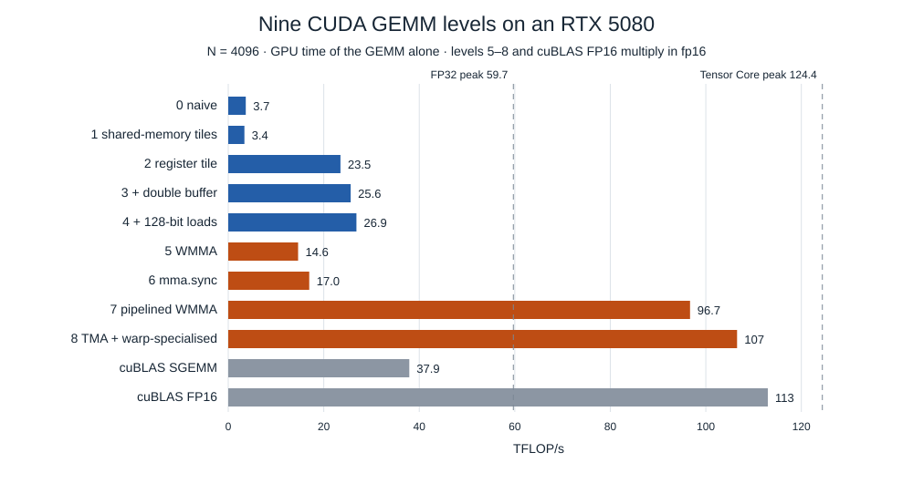

# Matrix multiplication on an RTX 5080: eight CUDA kernels from 3.7 to 100 TFLOP/s

*NVIDIA GeForce RTX 5080 (Blackwell, sm_120), CUDA 13.2. Every number was
measured on that GPU; the code is in
[hpc-math-core](https://github.com/vdeviatkov/hpc-math-core). Part 4 of a
series: [part 1](simd-gemm.md) builds the CPU SIMD kernel whose register
tile reappears here, [part 2](sme2-gemm.md) does the same on Apple's matrix
unit.*

The CPU articles in this series end with one core doing about 1.5 TFLOP/s
on a matrix unit. A consumer GPU has 84 streaming multiprocessors, each
with 128 FP32 lanes and four Tensor Cores. This article builds a single-
precision matrix multiplication for it in eight steps, measures each with
GPU timers and hardware counters, and explains every gain and every
regression.

**Key results**

- Measured limits of this GPU: **59.7 TFLOP/s FP32**, **124.4 TFLOP/s on
  the FP16 Tensor Cores** (fp32 accumulate), **812 GB/s** of DRAM bandwidth.
  A GEMM at N = 4096 needs 683 flops per DRAM byte at minimum, far above
  either ridge point: it is a question of on-chip reuse, not of DRAM.
- On the FMA cores, register tiling is the decisive step: **3.7 → 23.5
  TFLOP/s** (6.4×). With double buffering and 128-bit shared-memory reads
  the best FMA kernel reaches **27.5 TFLOP/s, 71% of cuBLAS SGEMM**.
- Tensor Cores alone do not help: the first WMMA kernel runs at 14.6
  TFLOP/s, **below** the FMA kernels, with 88% of its shared-memory loads
  hitting bank conflicts and the Tensor pipe busy 12% of the time. A
  pipelined kernel with 128 × 128 tiles and padded shared memory reaches
  **100.7 TFLOP/s**: 81% of the measured Tensor Core peak and 83–85% of
  cuBLAS FP16, with the Tensor pipe 86% busy.

## The machine, measured

A GPU executes threads in groups of 32, *warps*. Each SM keeps up to 48
warps resident and, every cycle, each of its four schedulers issues one
instruction from a warp that is ready. Latency is hidden by switching
between resident warps, so how many warps fit on an SM, its *occupancy*,
is set by the resources each thread block uses:

| RTX 5080 | |
|---|--:|
| SMs | 84 |
| FP32 lanes per SM | 128 |
| Tensor Cores per SM | 4 |
| Resident threads (warps) per SM | 1,536 (48) |
| Registers per SM | 65,536 × 32 bit |
| Shared memory per SM | 100 KiB |
| L2 cache, whole GPU | 64 MiB |
| DRAM | 16 GB, 256-bit bus |

A thread block of 256 threads at 128 registers per thread uses 32,768
registers, so two blocks fit and occupancy is 16 of 48 warps (33%). That
arithmetic decides several of the steps below.

The peaks are measured, not taken from the data sheet, by kernels that do
nothing else (`cuda_peak`): FMA chains on registers, `mma.sync` on
registers, and a 1 GiB copy. The SM clock depends on power: under the FP32
FMA load the board draws 300 W and runs at 2.83 GHz; under the others,
2.89 GHz.

| | Measured | Implied per SM per cycle |
|---|--:|--:|
| FP32 FMA | **59.7 TFLOP/s** | 251 flops: 98% of 128 lanes × 2 |
| FP64 FMA | 0.82 TFLOP/s (GEMM kernels reach 0.96) | ~2 lanes |
| FP16 Tensor Cores, fp32 accumulate | **124.4 TFLOP/s** | 512 flops |
| DRAM, copy | **812 GB/s** | |

Two ridge points follow: a kernel needs 59.7 / 0.812 = **74 flops per DRAM
byte** to be compute-bound on the FMA cores and **153** on the Tensor
Cores. A 4096 × 4096 FP32 GEMM does 137 Gflop on 192 MiB of matrices: 683
flops per byte if every element crosses DRAM once. With ideal reuse this size has enough arithmetic intensity to avoid
a DRAM bandwidth limit; it is how many times each element is fetched
from L2 and shared memory in practice.

### How the kernels are timed

Each kernel is timed alone, the way the CPU kernels in this series are: A,
B and C are allocated and filled on the GPU before timing, one untimed
call runs first, and the time is GPU time from CUDA events recorded
immediately before and after the launch. Copying the matrices over PCIe is
excluded: at N = 4096 it takes about 12 ms, several times the GEMM itself,
and in real use the data stays on the GPU. Counters come from Nsight
Compute at N = 4096 at the GPU's normal clock (`--clock-control none`).

## Level 0: one thread per output — 3.7 TFLOP/s

```cuda
const int i = blockIdx.y * blockDim.y + threadIdx.y;
const int j = blockIdx.x * blockDim.x + threadIdx.x;
float acc = 0;
for (int k = 0; k < K; ++k)
    acc += A[i * K + k] * B[k * N + j];
C[i * N + j] = acc;
```

This kernel is stronger than it looks. With a 16x16 thread block, a warp spans two 16-thread rows. Each
half-warp loads the same contiguous 16-element B segment and broadcasts
its own A(i,k). These requests coalesce into aligned 32-byte sectors; a
warp does not compute a single 32-column row segment here. The L1 cache catches 87% of the requests and L2 94% of the rest.
What limits it is instruction count: each FMA needs two loads, and the FMA
pipe is busy 13% of the time.

## Level 1: shared-memory tiles — 3.4 TFLOP/s, slower

A 16 × 16 thread block copies 16 × 16 tiles of A and B to shared memory and
computes from there, which cuts global loads 16-fold. It runs 8% *slower*.
The counters show why: the kernel still issues two loads per FMA, now from
shared memory (4.3 billion shared-load wavefronts for 2.1 billion warp
FMAs), and adds two `__syncthreads()` per 16 FMAs. Level 0's loads were
already served by L1; moving them to shared memory saved nothing that
mattered. Reuse has to happen in registers.

## Level 2: register tiling — 23.5 TFLOP/s

Each thread now computes an 8 × 8 block of C held in 64 registers. A block
of 256 threads covers 128 × 128 outputs and stages 128 × 16 tiles of A and
16 × 128 tiles of B in shared memory. Per k step, a thread reads 8 values
of A and 8 of B and performs their outer product, 64 FMAs:

```cuda
for (int k = 0; k < 16; ++k) {
    float a[8], b[8];
    for (int m = 0; m < 8; ++m) a[m] = As[k][tm + m];   // A tile stored transposed
    for (int n = 0; n < 8; ++n) b[n] = Bs[k][tn + n];
    for (int m = 0; m < 8; ++m)
        for (int n = 0; n < 8; ++n)
            acc[m][n] += a[m] * b[n];                    // 64 FMAs from 16 loads
}
```

This is the micro-kernel of the CPU articles, at thread level: four FMAs
per shared-memory load instead of one half. Arithmetic intensity for the A/B input traffic per block rises
to 32 flops per byte (excluding the output store). The result is **6.4× Level 0**, the largest single
step in the ladder.

The counters also show what remains. 128 registers per thread allow two
blocks per SM: **33% occupancy**. The FMA pipe is busy **50%** of the time.
And **47%** of the shared-memory load wavefronts are bank conflicts: the
16 threads of a half-warp read `Bs[k][tn + n]` with `tn` 8 floats apart,
so lanes 4 apart hit the same one of the 32 banks.

How the tiles are loaded matters as much as the arithmetic. In an earlier
version of this kernel, consecutive threads loaded consecutive *rows* of
the A tile, so a warp's 32 loads touched 32 different lines of A. Making
consecutive threads load consecutive elements of a row, so the loads
coalesce, and transposing in the store to shared memory instead, made this
level 27% faster and the next one 36%.

## Level 3: double buffering — 25.6 TFLOP/s

Two shared-memory buffers alternate: while the block computes on tile k,
the copy of tile k + 1 is in flight. On sm_80 and later the copy uses
`cp.async`, which moves data from global to shared memory without going
through registers and without blocking the thread, so the FMAs and the
copy overlap. **+9%**, and the fastest FMA kernel so far.

## Level 4: 128-bit loads — 27.5 TFLOP/s, 71% of cuBLAS

The A and B tiles are loaded with `float4` instructions, four elements per
load, and an XOR swizzle of the shared-memory layout replaces the +1
padding that would break their 16-byte alignment. The decisive change is
on the read side: a thread's 8 values of A and 8 of B are two aligned
`float4` slots each, so it reads them with four 128-bit loads instead of
sixteen 32-bit ones:

| `gemm_cuda_vectorized` at N = 4096 | Scalar shared reads | 128-bit shared reads |
|---|--:|--:|
| Registers per thread | 255 | **128** |
| Blocks per SM (occupancy) | 1 (17%) | 2 (33%) |
| TFLOP/s | 13.1 | **26.9** |

With scalar reads the kernel needed 255 registers, so one block fitted per
SM; the vector reads freed half of them. Shared-load bank conflicts fall
to 40% of wavefronts and the FMA pipe is busy 54% of the time. At N = 8192
the kernel reaches **27.5 TFLOP/s: 71% of cuBLAS SGEMM** (38.9 TFLOP/s)
and 46% of the FP32 peak; cuBLAS itself reaches 65% of that peak.

## Tensor Cores

A Tensor Core multiplies small matrix tiles in one instruction. A warp
issues `mma.sync.m16n8k16`: a 16 × 16 fp16 tile of A times a 16 × 8 fp16
tile of B, accumulated in fp32, 4,096 flops per instruction. The measured `mma.sync` path sustains about 512 flops per SM per cycle,
twice the 256-flop theoretical rate of its FMA lanes. This is the measured
rate of this instruction path, not a bound on every Blackwell Tensor Core API. They multiply fp16 inputs (10-bit mantissa), so results
introduce input rounding at roughly the 1e-3 scale. Output relative
error can be much larger near cancellation; fp16 also has a smaller range.

### Level 5: WMMA — 14.6 TFLOP/s, below the FMA kernels

The `wmma::` API wraps `mma.sync` in fragments. The first kernel gives
each warp one 16 × 16 output tile, a block of 4 × 4 warps a 64 × 64 tile,
and converts each fp32 tile to fp16 on its way into shared memory. At 14.6
TFLOP/s it is slower than Levels 2–4. The Tensor pipe is busy **12%** of
the time, and **88%** of the shared-memory load wavefronts are bank
conflicts. `wmma::load_matrix_sync` reads 16 rows of a fragment, and with a
64-element (128-byte) row pitch every row starts in the same bank. One
fragment per warp and one k-step per synchronisation also leave little
work to overlap anything with.

### Level 6: raw `ldmatrix` + `mma.sync` — 17.0 TFLOP/s

The same tiles, one level lower: `ldmatrix` loads shared memory straight
into the registers `mma.sync` expects, and the kernel chooses which
address each lane supplies. **+16%**, but the structure is unchanged, and
so is the problem: 80% of its shared-memory load wavefronts are bank
conflicts. The API was not the bottleneck.

### Level 7: pipelined Tensor Cores — 100.7 TFLOP/s

The final kernel changes the structure, the way CUTLASS-style kernels do:

1. **128 × 128 block tile, k-step 32**, so each `__syncthreads()` pair pays
   for 8× more work.
2. **Each warp owns 32 × 64 outputs**, 2 × 4 fragments, and issues 8 MMAs
   per k sub-step; each B fragment is loaded once for both rows of A
   fragments. This is register tiling again, at fragment granularity.
3. **Double buffering with `cp.async`**, as in Level 3. Because `cp.async`
   copies bytes without converting, A and B are converted to fp16 in global
   memory first.
4. **Padded shared memory.** Rows are padded by 8 halves (16 bytes), the
   smallest pad that keeps `load_matrix_sync` and `cp.async` aligned. It is
   the fix of [part 3](sme2-cache-associativity.md) in another memory: there,
   one extra cache line per row of B moved each row to a different cache
   set; here, 16 extra bytes per row move each row to different banks.

The padding alone was worth +24%, measured with Nsight Compute when it was
added:

| Level 7 at N = 4096 | Unpadded | Padded |
|---|--:|--:|
| Shared-load bank conflicts, share of wavefronts | 85% | **1%** |
| Tensor pipe utilisation | 68% | **86%** |
| TFLOP/s | 80.8 | **100.5** |

Today's profile of the kernel: Tensor pipe busy 86%, 1% bank conflicts,
DRAM traffic 116 MB for the whole multiplication (each matrix crosses DRAM
about once), and occupancy 32%, limited by 118 registers per thread. It
reaches **100.7 TFLOP/s at N = 8192: 81% of the measured Tensor Core peak
and 85% of cuBLAS FP16** at the same size (83% at N = 16384). Closing the
rest of the gap is beyond this article; the usual next steps are a deeper
pipeline (three or four stages instead of two) and split-K for shapes with
a large K.

## The ladder, measured



TFLOP/s, GPU event time of the GEMM, FP32 outputs. Levels 5–6 convert
FP32 inputs inside the kernel; level 7 receives preconverted FP16 inputs:

| Level | Kernel | N = 1024 | 4096 | 8192 | Occupancy | Registers | Pipe busy | Shared-load conflicts |
|---|---|--:|--:|--:|--:|--:|--:|--:|
| 0 | naive | 3.6 | 3.7 | 3.2 | 100% | 32 | FMA 13% | — |
| 1 | shared-memory tiles | 3.3 | 3.4 | 3.4 | 100% | 40 | FMA 7% | 0% |
| 2 | register tile | 14.1 | 23.5 | 24.6 | 33% | 128 | FMA 50% | 47% |
| 3 | + double buffer | 17.1 | 25.6 | 26.5 | 32% | 128 | FMA 56% | 47% |
| 4 | + 128-bit loads | 16.0 | 26.9 | **27.5** | 33% | 128 | FMA 54% | 40% |
| 5 | WMMA (fp16) | 10.7 | 14.6 | 14.1 | 98% | 40 | Tensor 12% | 88% |
| 6 | `mma.sync` (fp16) | 15.0 | 17.0 | 17.2 | 97% | 40 | Tensor 14% | 80% |
| 7 | pipelined WMMA (fp16) | 58.9 | 96.7 | **100.7** | 32% | 118 | Tensor 86% | 1% |

The counters (N = 4096) make one point clearly: occupancy does not decide
speed. Levels 5 and 6 keep 97–98% of warp slots busy and run at 14–17
TFLOP/s; Level 7 keeps 32% busy and runs at 97. What decides speed is how
many useful operations each byte loaded from shared memory feeds, and
whether those loads conflict.

Against the vendor library:

| TFLOP/s | N = 4096 | 8192 | 16384 |
|---|--:|--:|--:|
| Level 4, FMA cores | 26.9 | 27.5 | 27.4 |
| cuBLAS SGEMM, FMA cores | 37.9 | 38.9 | 39.0 |
| cuBLAS TF32, Tensor Cores | 52.9 | 59.2 | 60.9 |
| **Level 7, FP16 Tensor Cores** | **96.7** | **100.7** | **99.8** |
| cuBLAS FP16, Tensor Cores | 113.0 | 119.1 | 120.0 |

### Small matrices and FP64

At N = 256 the tiled kernels are the slowest of all (0.7–0.8 TFLOP/s
against 2.0 for Level 0): a 128 × 128 block tile gives 4 thread blocks for
84 SMs. The ranking settles from N = 1024.

In FP64 every kernel, cuBLAS DGEMM included, lands at 0.85–0.96 TFLOP/s:
about 1/64 of the FP32 rate, the FP64 throughput of consumer Blackwell.
The ladder does not apply there.

## Correctness

Every kernel is compared element by element with a CPU reference
([`tests/test_gemm_cuda.cpp`](https://github.com/vdeviatkov/hpc-math-core/blob/main/tests/test_gemm_cuda.cpp)).
An element passes if its relative error is below 1e-4 (FP32 kernels),
1e-10 (FP64) or 1e-2 (fp16 Tensor Core and TF32 paths), with the relative
denominator clamped to at least 1, or its absolute
error below 1e-3 / 1e-9 / 1e-2. Inputs are uniform in [−1, 1]. Each kernel
runs several square sizes between 17 and 512, and every kernel with bounds
checks also runs shapes with partial tiles in every dimension
(17 × 33 × 65, 129 × 37 × 131, and 132 × 68 × 260, which is a multiple of
the vector width but not of any tile). The fallbacks of Levels 4 and 7
have shapes of their own.

## Limitations

- **One GPU, one toolkit.** RTX 5080, CUDA 13.2, driver 615.71. Clocks
  move with power and temperature (2.83–2.90 GHz here); results on other
  boards will differ by more than that.
- **The FP16 levels are not FP32 GEMMs.** They round inputs to 10-bit
  mantissas; their TFLOP/s are not comparable with the FP32 rows.
- **No autotuning.** Tile sizes are fixed by hand for this GPU; the Matrix wrappers
  handle rectangular and empty shapes within their 32-bit indexing limit,
  but are tuned for large square ones. The raw pipelined device entry point
  requires exact tile multiples.
- **The FP64 microbenchmark reads lower than the FP64 GEMMs** (0.82 vs
  0.96 TFLOP/s). Its loop compiles with padding instructions between
  dependent FMAs; the GEMM kernels are the better measure of the FP64 rate.

## Takeaways

1. **Measure the roof first.** 59.7 TFLOP/s FP32 and 124.4 on the Tensor
   Cores turn every later number into a percentage of something real.
2. **Reuse in registers, not in shared memory.** Moving loads from L1 to
   shared memory (Level 1) gains nothing; giving each thread 64 outputs
   (Level 2) gains 6.4×.
3. **Count loads per useful operation, then count conflicts.** 128-bit
   shared reads doubled Level 4 by freeing registers; padding each
   shared-memory row by 16 bytes made Level 7 24% faster.
4. **Tensor Cores need the same discipline.** Dropped into a structure
   built for FMAs, they ran slower than the FMAs; restructured around them,
   they ran 3.7× faster than the best FMA kernel.

## The series

The same multiplication, four times: one CPU core with vector FMAs reaches
333 GFLOP/s ([part 1](simd-gemm.md)), Apple's SME2 matrix unit 1.5 TFLOP/s
([part 2](sme2-gemm.md)), and this GPU 27.5 TFLOP/s on its FMA cores and
100 on its Tensor Cores. Every one of those kernels is built the same way:
a block of C held in registers or accumulator tiles, enough independent
accumulators to cover the latency of the multiply-add unit, operands staged
so that each loaded byte feeds many operations, and a layout that keeps
those loads out of each other's way, in cache sets ([part
3](sme2-cache-associativity.md)) or in shared-memory banks.

## Reproduce

```bash
git clone https://github.com/vdeviatkov/hpc-math-core && cd hpc-math-core
cmake -B build -G Ninja -DCMAKE_BUILD_TYPE=Release
cmake --build build
ctest --test-dir build                          # includes every CUDA level
./build/benchmarks/cuda_peak                    # peaks and bandwidth
./build/benchmarks/bench_gemm_cuda              # every level, every size
ncu --clock-control none -k regex:kernel_vectorized --launch-skip 1 --launch-count 1 \
    ./build/benchmarks/bench_gemm_cuda --benchmark_filter='CudaVectorized/f32/N=4096'
```

The kernels are in
[`src/cuda/gemm_kernels.cu`](https://github.com/vdeviatkov/hpc-math-core/blob/main/src/cuda/gemm_kernels.cu),
in level order. Raw data, profiles and method:
[experiments/cuda-machine](https://github.com/vdeviatkov/hpc-math-core/tree/main/docs/experiments/cuda-machine).
