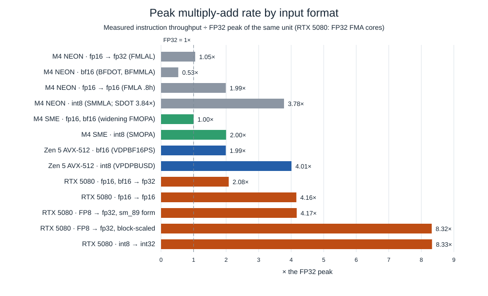

# Matrix multiplication in bf16, fp16, INT8 and FP8: what changes on CPUs, SME2 and Tensor Cores

*Apple M4 Max (one P-core and its SME2 unit), AMD Ryzen 9 9950X (one Zen 5
core) and an NVIDIA RTX 5080. Every number was measured on those machines;
the code is in [hpc-math-core](https://github.com/vdeviatkov/hpc-math-core).
Part 5 of a series: [part 1](simd-gemm.md) builds the FP32 kernels on CPU
vector units, [part 2](sme2-gemm.md) on Apple's SME2 matrix unit,
[part 4](cuda-gemm.md) on the GPU. This part changes only the number
format.*

Parts 1–4 multiplied FP32 matrices. Most matrix multiplications that run
today, in neural-network inference and training, do not: they use 16-bit
floats (fp16, bf16), 8-bit integers, or 8-bit floats (FP8). Halving the
element width halves the bytes moved, and most hardware also executes the
narrower multiply-adds faster. This article measures by how much on each
unit of the series, shows what a kernel has to change to get it, and
measures what each format costs in accuracy.

**Key results**

- **The speed-up is a property of the instruction, not of the bit count.**
  Measured peaks relative to FP32 on the same unit range from **0.53×**
  (bf16 on M4 NEON: slower than FP32) through **1.0×** (fp16 and bf16 on
  M4 SME2: no faster) to **4×** (INT8 on Zen 5) and **8.3×** (INT8 and FP8
  on the RTX 5080, against its FP32 cores).
- **The accumulator decides as much as the inputs.** On the RTX 5080 and on
  M4 NEON, fp16 inputs run twice as fast when the sums are also kept in
  fp16, at an error that grows with K: 0.2% relative at K = 256, 1.9% at
  K = 16,384.
- **FP8 on the RTX 5080 has two instructions.** The portable one runs at
  249 TFLOP/s with FP32 accumulation; the block-scaled "MX" one at 497, the
  only FP32-accumulating Tensor Core instruction here that runs at full
  rate. It needs an `sm_120a` build. cuBLAS
  uses it; switching the hand-written kernels to it took FP8 from 214 to
  291 TFLOP/s (cp.async kernel) and from 233 to 387 (part 4's Level 8).
- **The kernels:** INT8 reaches 3,525 GOP/s on one M4 SME2 unit and 1,138
  on one Zen 5 core, 2.3× and 3.8× their FP32 kernels at N = 2,048, and
  419 TOP/s on the RTX 5080 at N = 16,384 (98% of cuBLAS). Each CUDA kernel serves all
  five formats; only the `mma.sync` instruction and the element width
  change. Part 4's Level 8 reaches 97–102% of cuBLAS in every format at
  N = 8,192 (97–103% at 16,384).

## The formats

| Format | Bits: sign / exponent / mantissa | Largest value | Largest relative rounding of one input | Typical accumulator |
|---|---|--:|--:|---|
| FP32 | 1 / 8 / 23 | 3.4 × 10³⁸ | 2⁻²⁴ ≈ 6 × 10⁻⁸ | FP32 |
| bf16 | 1 / 8 / 7 | 3.4 × 10³⁸ | 2⁻⁸ ≈ 3.9 × 10⁻³ | FP32 |
| fp16 | 1 / 5 / 10 | 65,504 | 2⁻¹¹ ≈ 4.9 × 10⁻⁴ | FP32 or fp16 |
| FP8 E4M3 | 1 / 4 / 3 | 448 | 2⁻⁴ ≈ 6 × 10⁻² | FP32 |
| INT8 | integer, with a scale | ±127 × scale | depends on the scale | INT32 |

bf16 keeps FP32's exponent and drops mantissa bits, so it has FP32's
range; fp16 keeps more mantissa and loses range. E4M3 has
one significant decimal digit. INT8 values are integers: a real matrix is
stored as `scale × q` with `q` in −127 … 127, and the scale is chosen per
row, per column or per tensor.

What that costs in a product, measured: A (64 × K) and B (K × 64) are FP32,
uniform in [−1, 1), the exact product is computed in double, and each
format rounds the inputs (or quantises them, INT8 with one scale per row
of A and per column of B) and accumulates as the kernels below do
([`lowp_accuracy`](https://github.com/vdeviatkov/hpc-math-core/blob/main/benchmarks/experiments/lowp_accuracy.cpp)):

| ‖C − C_exact‖ / ‖C_exact‖ | K = 256 | 1,024 | 4,096 | 16,384 |
|---|--:|--:|--:|--:|
| FP32 inputs, FP32 accumulation | 2.0 × 10⁻⁷ | 4.1 × 10⁻⁷ | 7.9 × 10⁻⁷ | 1.6 × 10⁻⁶ |
| fp16, FP32 accumulation | 2.6 × 10⁻⁴ | 2.7 × 10⁻⁴ | 2.6 × 10⁻⁴ | 2.7 × 10⁻⁴ |
| bf16, FP32 accumulation | 2.1 × 10⁻³ | 2.1 × 10⁻³ | 2.2 × 10⁻³ | 2.1 × 10⁻³ |
| INT8, per-row / per-column scales | 5.5 × 10⁻³ | 5.7 × 10⁻³ | 5.6 × 10⁻³ | 5.7 × 10⁻³ |
| FP8 E4M3, FP32 accumulation | 3.3 × 10⁻² | 3.4 × 10⁻² | 3.4 × 10⁻² | 3.4 × 10⁻² |
| fp16, **fp16 accumulation** | 2.3 × 10⁻³ | 4.6 × 10⁻³ | 9.5 × 10⁻³ | **1.9 × 10⁻²** |

With a wide accumulator, the error is the rounding of the inputs and does
not grow with K: each product of rounded inputs is exact in FP32, and the
sum adds little. With an fp16 accumulator the sum's own rounding dominates
and grows with K, past bf16's error from K ≈ 256 on. (The fp16 row rounds
after every addition; a Tensor Core `mma` adds 16 products per
instruction and presumably rounds less often, so it should sit below
that row, which is the pessimistic end.) With normally distributed inputs INT8's error roughly
doubles (1.0–1.4 × 10⁻²): a few large values stretch the scale and
coarsen every other value. Which of these errors a workload tolerates is a
question about the workload; this article measures the cost and the speed.

## What a format changes in a kernel

Parts 1–4 built every fast kernel the same way: a block of C held in
registers or accumulator tiles, updated by outer products of a column
segment of A and a row segment of B. With narrow inputs, three things
change.

**1. The instruction becomes a short dot product.** Narrow inputs are
multiplied into a 32-bit accumulator. To keep each 32-bit lane busy, the
instruction reads a group of G consecutive k values (G = 2 for 16-bit
inputs, 4 for 8-bit) and adds their dot product to the lane:

```text
FP32 FMA, per lane:          c += a[k] · b[k]
widening, per lane:          c += a[k]·b[k] + a[k+1]·b[k+1]                     G = 2 (bf16, fp16)
                             c += a[k]·b[k] + … + a[k+3]·b[k+3]                 G = 4 (INT8)
```

Each instruction thus does G times the multiply-adds of an FP32 FMA on the
same register width. On SME2 the same holds per element of the outer
product: a widening `FMOPA` adds, to each element of a 16 × 16 FP32 tile,
a dot product of length 2 instead of a single product.

**2. Packing must group k.** The instruction needs the G values of one
k group side by side in the register. For A, whose rows run along k, they
already are. For B, whose rows run along n, the G values of a group are G
rows apart, so B has to be packed with G rows interleaved:

```text
row-major B (k down, n across)       packed B for G = 2: each 32-bit word = one k group of one column
k0:  b00 b01 b02 b03 …               [b00 b10] [b01 b11] [b02 b12] [b03 b13] …
k1:  b10 b11 b12 b13 …               [b20 b30] [b21 b31] [b22 b32] [b23 b33] …
k2:  b20 b21 b22 b23 …
k3:  b30 b31 b32 b33 …
```

In part 2 packing B was an optimisation (it removed a cache-set
conflict). Here it is a requirement: no load instruction can deliver an
interleaved group from row-major B. And K must be padded to a multiple of
G, with zeros, which add nothing to the sums.

**3. The accumulator width is a choice.** fp16 inputs can be summed in
FP32 or in fp16. Where the hardware offers both, the fp16 form is twice as
fast, for the reason the table above shows.

The CPU kernels below keep part 1's and part 2's structure (register tile,
cache blocking, packing) and change these three things. The GPU kernel
keeps part 4's structure.

## The peaks

Every instruction was measured as in part 1's `fma_peak`: a loop on
constant registers with 1, 8 or 16 independent accumulators (on SME2,
1 or 4 ZA tiles), no memory traffic
([`lowp_peak`](https://github.com/vdeviatkov/hpc-math-core/blob/main/benchmarks/experiments/lowp_peak.cpp);
GPU: [`cuda_peak`](https://github.com/vdeviatkov/hpc-math-core/blob/main/benchmarks/experiments/cuda_peak.cu)).
Rates count a multiply-add as 2 operations for every format, so they
compare directly:



| Unit | Instruction | Inputs → accumulator | Latency, cycles | Peak | × FP32 |
|---|---|---|--:|--:|--:|
| M4 P-core, NEON | `FMLA .4s` | fp32 → fp32 | 3.4 | 135 GFLOP/s | 1 |
| | `FMLAL` | fp16 → fp32 | 4.0 | 143 | 1.05 |
| | `BFDOT` / `BFMMLA` | bf16 → fp32 | 2.8 / 4.9 | 71 | **0.53** |
| | `FMLA .8h` | fp16 → fp16 | 3.4 | 268 | 2.0 |
| | `SDOT` / `SMMLA` | int8 → int32 | 3.0 / 6.0 | 519 / 511 GOP/s | 3.8 |
| M4 SME2 unit | `FMOPA` (4 tiles) | fp32 → fp32 | 4.5 | 2,018 GFLOP/s | 1 |
| | widening `FMOPA`, `BFMOPA` | fp16, bf16 → fp32 | 9.1 | 2,014–2,018 | **1.0** |
| | `SMOPA` | int8 → int32 | 4.5 | 4,029 GOP/s | 2.0 |
| Zen 5 core, AVX-512 | `VFMADD231PS` | fp32 → fp32 | 4.0 | 358 GFLOP/s | 1 |
| | `VDPBF16PS` | bf16 → fp32 | 6.0 | 713 | 2.0 |
| | `VPDPBUSD` | u8 × s8 → int32 | 4.0 | 1,435 GOP/s | 4.0 |
| RTX 5080, `mma.sync` | FMA cores (part 4) | fp32 → fp32 | | 59.7 TFLOP/s | 1 |
| | `m16n8k16` | fp16, bf16 → fp32 | | 124 | 2.1 |
| | `m16n8k16` | fp16 → fp16 | | 249 | 4.2 |
| | `m16n8k32` | e4m3 → fp32 | | 249 | 4.2 |
| | `m16n8k32 kind::mxf8f6f4.block_scale` | e4m3 → fp32 | | **497** | 8.3 |
| | `m16n8k32` | e4m3 → fp16 | | 497 | 8.3 |
| | `m16n8k32` | int8 → int32 | | 497 TOP/s | 8.3 |

(Latency is per instruction with one accumulator; on SME2, with one ZA
tile. The FP32 rows differ from earlier parts because the sessions and
the loops differ: the M4 P-core ran at 4.47 GHz here, and NEON FP32's 135
GFLOP/s is 30.2 flops per cycle, 5% below the 31.8 that part 1's
`fma_peak` measured; the FP32 `FMOPA` peak is 2,018 GFLOP/s here and 1,963
in part 2, where the core ran at 3.94–3.99 GHz: the SME unit gained 3%
while the core clock gained 12%, so its rate does not follow the core
clock, and its cycle counts here are in core cycles. Zen 5's 358 against
part 1's 362 is run-to-run variation at the same clock (5.70–5.71 GHz).
Every ratio in this table compares rows from the same run.)

Three findings in this table decide everything below.

**On the M4 the 16-bit floating-point formats buy little or nothing in
compute.** On NEON, `FMLAL` widens 4 fp16 values per instruction, the same
4 products as an FP32 `FMLA`, at the same rate: fp16 storage, FP32 speed.
`BFDOT` and `BFMMLA` issue at 1 and 0.5 per cycle where FP32 FMAs issue at
nearly 4: bf16 computes at half FP32's rate. On the SME2 unit, the widening
`FMOPA` does twice the work of the FP32 one but takes twice as long
(2.27 against 1.13 cycles per instruction with four tiles), so the peak is
identical. The 16-bit formats still halve the bytes that must be loaded and
packed, which matters below; the arithmetic is not faster.

**The accumulator width is the second axis.** On NEON, fp16 → fp16
(`FMLA .8h`, 8 lanes) is twice FP32; fp16 → FP32 is not. On the RTX 5080,
a GeForce card, every `mma.sync` with an FP32 accumulator runs at half
the rate of its 16-bit-accumulator form, 124 against 249 for fp16 and 249
against 497 for FP8, except the block-scaled FP8 form (below), which runs
at the full 497. INT8 accumulates in INT32 and is not affected.

**INT8 is the format every unit accelerates:** 3.8× FP32 on NEON, 2× on
SME2, 4× on AVX-512, and the same 497 TOP/s as the fastest FP8 form on the
GPU.

## CPU kernels

The CPU kernels keep the FP32 kernels' structure: a register tile of C,
three-level cache blocking and packing, now with the k-group packing above
and block sizes re-chosen in bytes. Inputs are converted before
timing, as a real workload stores them; packing is timed, as in parts 1–2
([`bench_gemm_lowp`](https://github.com/vdeviatkov/hpc-math-core/blob/main/benchmarks/bench_gemm_lowp.cpp)).
Medians of 3 repetitions, one thread:

### Zen 5, AVX-512

Code: [`gemm_simd_lowp`](https://github.com/vdeviatkov/hpc-math-core/blob/main/src/gemm/simd.hpp) with [`ZmmDot<In>`](https://github.com/vdeviatkov/hpc-math-core/blob/main/src/gemm/avx512.hpp).

The micro-kernel is an 8 × 2-register tile (8 rows × 32 columns of C,
16 accumulators) with `VDPBF16PS` or `VPDPBUSD` in place of the FMA. Per
k group it loads two vectors of packed B (one 32-bit word per column) and
broadcasts one 32-bit word of A per row: G consecutive k of one row,
already contiguous in row-major A, so A is read in place. Only B is
packed, because only B's layout is wrong for the instruction.

`VPDPBUSD` multiplies *unsigned* bytes by signed bytes, and Zen 5 has no
signed × signed form. B is packed as b + 128 (flipping each byte's sign
bit makes it unsigned), A stays signed, and the accumulators of row i start
at −128 · Σₖ A(i,k), which cancels the excess. The result is exact.

The intrinsic `_mm512_dpbusd_epi32` hid a compiler problem: GCC 13
surrounds every `VPDPBUSD` with register copies of its accumulator, 61
instructions per k group for 16 dot products. At Zen 5's two dot products
per cycle a k group needs 8 cycles, and 61 instructions in 8 cycles is at
the core's documented 8-wide dispatch, so the front end, not the
dot-product units, set the pace. Written as a one-instruction `asm`, the
loop is 30 instructions and runs 16–26% faster (three alternated runs of
each version; `VDPBF16PS` compiles without the copies):

| `gemm_simd_lowp<ZmmDot>` INT8, GOP/s | N = 256 | 1,024 | 2,048 | 4,096 |
|---|--:|--:|--:|--:|
| intrinsic (and A packed) | 709 | 901 | 930 | 885 |
| one-instruction `asm` | **826** | **1,138** | **1,138** | **1,037** |

All three kernels in one session, the current versions:

| GFLOP/s or GOP/s | N = 256 | 1,024 | 2,048 | 4,096 | best, % of peak |
|---|--:|--:|--:|--:|--:|
| FP32, `gemm_simd_blocked<Zmm>` | **325** | 311 | 302 | 295 | 91% |
| bf16 | 619 | **638** | 606 | 574 | 90% |
| INT8 | 824 | **1,139** | 1,138 | 1,038 | 79% |

At N = 4,096 bf16 is 1.9× and INT8 3.5× faster than FP32; best size
against best size, 2.0× and 3.5×, against peak ratios of 2.0 and 4.0.
bf16 and INT8 drop from N = 2,048 to 4,096, probably because A is now
read in place: at N = 4,096 its rows are 8 or 4 KiB apart, the stride
conflict of part 1, which packing A avoided. bf16 is 2% slower at
N = 4,096 than with A packed, and 1–9% faster at the other sizes; at
N = 4,000 it is not slower.

### Apple M4, NEON

Code: [`gemm_simd_lowp`](https://github.com/vdeviatkov/hpc-math-core/blob/main/src/gemm/simd.hpp) with [`QMmla<In>`, `QFmlal<In>`, `QFmlaF16<In>`](https://github.com/vdeviatkov/hpc-math-core/blob/main/src/gemm/neon.hpp).

`BFMMLA` and `SMMLA` are not vector FMAs but tiny matrix multiplications:
each takes a 2 × G block of A and a G × 2 block of B, one 128-bit register
each (G = 4 bf16 or 8 INT8), and adds their 2 × 2 product to a 2 × 2 tile
of C held in one register. The micro-kernel arranges 16 such tiles into an
8 × 8 block of C: per k group, 4 registers of A (row pairs) and 4 of B
(column pairs) feed 16 instructions, the outer product of part 1 at the
granularity of 2 × 2 tiles. `FMLAL` and `FMLA .8h` keep the 4 × 4 tile
that part 1's FP32 kernel used until it moved to 6 × 4.

| GFLOP/s or GOP/s | N = 256 | 1,024 | 2,048 | 4,096 | best, % of peak |
|---|--:|--:|--:|--:|--:|
| FP32, `gemm_simd_blocked<Q>` | **122** | 121 | 118 | 101 | 90% |
| bf16, `BFMMLA` | **66** | **66** | **66** | 65 | 93% |
| fp16 → FP32, `FMLAL` | 109 | **114** | 113 | 112 | 80% |
| fp16 → fp16, `FMLA .8h` | 204 | **216** | 214 | 209 | 81% |
| INT8, `SMMLA` | 449 | 493 | **503** | 491 | 98% |

(All rows from one session on 2026-10-22, with the FP32 kernel's current
6 × 4 tile and cache block; the low-precision rows are 0.7–2% below the
first run on 2026-10-16.)

The kernels follow the peaks. bf16 is the slowest kernel in the table
while running at 93% of its instruction's rate. `FMLAL` has FP32's
arithmetic rate and moves half the bytes, yet runs 6% below the FP32
kernel at N = 1,024: the FP32 kernel's larger tile and its `LDR` loads of
A ([docs/kernels/neon.md](https://github.com/vdeviatkov/hpc-math-core/blob/main/docs/kernels/neon.md))
gained more than the halved bytes; the fp16 kernels have neither. fp16 accumulation runs at 1.8× FP32 at N = 1,024–2,048. `SMMLA` runs at
98% of its own peak (97% of `SDOT`'s) and 4.1–4.3× the FP32 kernel at
N = 1,024–2,048: an 8 × 8 C block needs
only 8 registers of operands per 16 instructions, so the loads never limit
it.

### Apple M4, SME2

Code: [`gemm_sme<fp16 | bf16 | int8_t>`](https://github.com/vdeviatkov/hpc-math-core/blob/main/src/gemm/sme.hpp).

Part 2's kernel with the widening instruction: four ZA tiles hold a 32 × 32
FP32 (or INT32) block of C, and each k group issues four widening
`FMOPA`s (fp16, bf16) or `SMOPA`s (INT8). The packed strips hold one 32-bit
word per row and k group. A is packed with part 2's NEON 4 × 4 transposes,
now of 32-bit words that each carry G inputs; B by zipping G rows together.
The blocks keep part 2's sizes in bytes: Kc = 4,096 16-bit or 8,192 INT8
elements, so an A block is still 8 MiB.

| GFLOP/s or GOP/s, one thread | N = 256 | 1,024 | 2,048 | 4,096 | best, % of peak |
|---|--:|--:|--:|--:|--:|
| FP32, `gemm_sme` | 779 | 1,440 | **1,540** | 1,535 | 76% |
| fp16 → FP32 | 967 | 1,689 | 1,732 | **1,756** | 87% |
| bf16 → FP32 | 967 | 1,691 | 1,737 | **1,774** | 88% |
| INT8 → INT32 | 1,579 | 3,148 | **3,525** | 3,413 | 87% |

The 16-bit kernels are 12–17% faster than FP32 from N = 1,024 on,
although their peak is the same. With the same block sizes in bytes, every k step of the
micro-kernel loads the same 256 bytes of A and B but performs twice the
multiply-adds, and packing moves half the bytes per operation; the FP32
kernel's losses to loads and packing shrink, and the widening kernels
run closer to the unit's peak (87–88% against 76%). INT8 doubles the
arithmetic and keeps the same efficiency: 2.3× the FP32 kernel at N = 2,048.

## The GPU kernel

Code: [`kernel_lowp`, `kernel_tma` and the five `mma` formats](https://github.com/vdeviatkov/hpc-math-core/blob/main/src/cuda/gemm_lowp.cu),
API in [`cuda_lowp.hpp`](https://github.com/vdeviatkov/hpc-math-core/blob/main/src/gemm/cuda_lowp.hpp).

On the GPU the k grouping is inside the instruction: an `mma.sync` fragment
of an 8-bit operand holds 4 consecutive k per 32-bit register, of a 16-bit
operand 2. Part 4's Level 6 loaded B with `ldmatrix .trans`, which
transposes 16-bit elements on the way from shared memory: applied to 8-bit
data it would move pairs of k values together, not single ones. So this kernel takes both operands
**K-major**: A as M × K row-major, B transposed, N × K row-major. Then
every shared-memory tile, of every format, is "rows of K bytes", and one
non-transposing `ldmatrix.x4` loads a fragment of any of them: a 16-row ×
32-byte A fragment is 16 k values of fp16 or 32 of INT8, and the register
layout `mma.sync` expects is the same for `m16n8k16` (16-bit) and
`m16n8k32` (8-bit). One kernel template serves all five formats; the
format supplies only the instruction:

| Format | Instruction | Accumulator |
|---|---|---|
| bf16 | `mma.sync.m16n8k16.row.col.f32.bf16.bf16.f32` | 4 FP32 per lane |
| fp16 | `mma.sync.m16n8k16.row.col.f32.f16.f16.f32` | 4 FP32 |
| fp16 → fp16 | `mma.sync.m16n8k16.row.col.f16.f16.f16.f16` | 2 registers of fp16 pairs |
| INT8 | `mma.sync.m16n8k32.row.col.s32.s8.s8.s32` | 4 INT32 |
| FP8 E4M3 | `mma.sync.m16n8k32.row.col.f32.e4m3.e4m3.f32`, or the block-scaled form (below) | 4 FP32 |

The rest is part 4's Level 7, written with raw `mma.sync` instead of WMMA:
a 128 × 128 block tile, 64 bytes of K per stage, 8 warps of 64 × 32
(Level 7: 32 × 64),
`cp.async` double buffering, shared-memory rows padded by 16 bytes (an
80-byte stride: the eight 16-byte rows an `ldmatrix` phase reads start in
banks 0, 20, 8, 28, 16, 4, 24, 12 and never conflict). Two settings were
chosen by measurement on all formats at N = 4,096 to 16,384
([`tuning_cp_async.csv`](https://github.com/vdeviatkov/hpc-math-core/blob/main/docs/experiments/lowp/tuning_cp_async.csv)):

- **Two pipeline stages, not three or four.** Three stages need 60 KiB of
  shared memory per block, so only one block fits in an SM's 100 KiB; two
  stages (40 KiB) fit two blocks, and measured 8–17% faster for every
  format.
- **Grouped block order.** Blocks are numbered so that consecutive blocks
  walk down 8 rows of tiles before moving right; the blocks resident at one
  time then share a few strips of A and of B, which stay in the 64 MiB L2.
  In row-major order each row of tiles streams all of B through L2 again.
  The faster the format, the more this matters: at N = 16,384 INT8 goes
  from 181 to 308 TOP/s, bf16 from 97 to 110 TFLOP/s.

The second kernel is [part 4's Level 8](cuda-gemm.md), `kernel_tma`, with
the same format structs: a producer warp loads each 128- or 256-row ×
64-byte tile with
one TMA instruction into hardware-swizzled shared memory, and four or eight
consumer warps of 64 × 64 run only `ldmatrix` and `mma.sync`, synchronised
by `mbarrier`s through a 4- or 6-stage pipeline. Both operands being
K-major is what lets TMA serve every format: a tile is always 64 bytes of
k per row, whatever the element width.

### Results

GPU-event time of the GEMM alone, as in part 4, inputs already in the
format on the GPU
([`bench_gemm_lowp_cuda`](https://github.com/vdeviatkov/hpc-math-core/blob/main/benchmarks/bench_gemm_lowp_cuda.cpp));
cuBLAS through `cublasGemmEx`, and `cublasLtMatmul` for FP8. Medians of 3:

| TFLOP/s or TOP/s, N = 8,192 | cp.async kernel | Level 8 (TMA) | cuBLAS | Level 8 ÷ cuBLAS | Level 8, % of peak |
|---|--:|--:|--:|--:|--:|
| bf16 → FP32 | 108.7 | **117.8** | 120.1 | 98% | 95% |
| fp16 → FP32 | 107.7 | **117.3** | 118.8 | 99% | 94% |
| fp16 → fp16 | 150.3 | **205.8** | 202.0 | 102% | 83% |
| INT8 → INT32 | 298.3 | **408.2** | 419.0 | 97% | 82% |
| FP8 → FP32, block-scaled `mma` (`sm_120a` build) | 291.4 | **387.3** | 399.9 | 97% | 78% |
| FP8 → FP32, sm_89 `mma` (plain `sm_120` build) | 213.6 | **232.8** | | | 94% |

For reference, part 4's FP32 results on the same GPU: 38.9 TFLOP/s for
cuBLAS SGEMM on the FMA cores, 59.2 for cuBLAS TF32 on the Tensor Cores.
INT8 and FP8 run 6.5–7× faster than TF32, in cuBLAS and in Level 8
alike. At N = 16,384 every figure is within 3% of N = 8,192; there Level 8
reaches 120.5 (bf16), 209.6 (fp16 → fp16), 419.0 (INT8) and 398.0 (FP8),
97–103% of cuBLAS. At small sizes Level 8 is ahead in the 8-bit formats:
at N = 1,024, 192 TOP/s against cuBLAS's 162 (INT8) and 171 (FP8).

### FP8: the instruction that runs at full rate

The first FP8 kernel used the `mma.sync … e4m3.e4m3.f32` instruction
introduced with the previous generation (sm_89) and reached 214 TFLOP/s,
86% of that instruction's measured 249. cuBLAS reached 400, above that
instruction's ceiling. Nsight Compute showed the instruction cuBLAS
executes: `QMMA.SF.16832.F32.E4M3.E4M3.E8`, a **block-scaled** MMA (the
"MX" microscaling formats). It multiplies each group of 32 elements along
k by a power-of-two scale stored as an 8-bit exponent (UE8M0), and it runs
at the full 497 TFLOP/s with an FP32 accumulator. With every scale set to
2⁰ = 1 it computes the plain product:


```cuda
// e4m3 x e4m3 -> fp32, scale factors all 2^0 (UE8M0 127)
asm volatile("mma.sync.aligned.m16n8k32.row.col.kind::mxf8f6f4.block_scale.scale_vec::1X"
             ".f32.e4m3.e4m3.f32.ue8m0 {%0,%1,%2,%3}, {%4,%5,%6,%7}, {%8,%9}, {%0,%1,%2,%3}, "
             "%10, {%11,%11}, %10, {%11,%11};"
             : "+f"(c[0]), "+f"(c[1]), "+f"(c[2]), "+f"(c[3])
             : "r"(a[0]), "r"(a[1]), "r"(a[2]), "r"(a[3]), "r"(b[0]), "r"(b[1]),
               "r"(0x7f7f7f7fu), "h"((unsigned short)0));
```


The instruction exists only for the architecture-specific target
`sm_120a` (CMake: `CMAKE_CUDA_ARCHITECTURES=120a`); a plain `sm_120` build
cannot emit it. The kernel uses it when built for that target, and the
FP8 GEMM goes from 214 to 291 TFLOP/s in the cp.async kernel and from 233
to 387 in Level 8, with identical results. Without it, FP8's peak on this
GPU is no higher than fp16 with fp16 accumulation (249), and its inputs are
far coarser than bf16's.

### What Level 8 removes

The cp.async kernel reaches 87% of the peak and 91% of cuBLAS in bf16 and
fp16 with FP32 accumulation, but the three formats whose instruction is
twice as fast (fp16 → fp16 at 249, INT8 and FP8 at 497) reach 150, 298 and
291, 71–74% of cuBLAS. They perform the same `mma` instructions
per byte of shared memory as the 16-bit formats (one `ldmatrix.x4`
delivers 16 k values of fp16 or 32 of INT8, for one instruction either
way), but those instructions finish twice as fast, so everything else in
the loop must also go twice as fast: address arithmetic, `cp.async` issue,
`ldmatrix` issue. Nsight Compute at N = 8,192
([`ncu_lowp_N8192.csv`](https://github.com/vdeviatkov/hpc-math-core/blob/main/docs/experiments/lowp/ncu_lowp_N8192.csv)):

| N = 8,192 | | cp.async kernel | Level 8 | cuBLAS |
|---|---|--:|--:|--:|
| FP8 | warp instructions | 546 M | 319 M | 232 M |
| | of which `mma` | 134 M | 134 M | 134 M |
| | Tensor pipe busy | 65% | 93% | 95% |
| | time, ms | 3.72 | 2.67 | 2.60 |
| bf16 | warp instructions | 1,099 M | 656 M | 600 M |
| | Tensor pipe busy | 90% | 99% | 98% |

All three run the same 134 million FP8 `mma` (268 million for bf16); what
differs is everything around them. Three quarters of the cp.async
kernel's instructions are outside the `mma` (copies, address arithmetic,
`ldmatrix`, loop control), and its Tensor pipe is 65% busy. Level 8 hands the copies to the TMA engine and the address
arithmetic to the swizzle, and the pipe is 93% busy. cuBLAS's FP8 and INT8
kernels (`nvjet_sm120_…_256x128x128_…_tmaAB…`) use the same TMA loads with
larger 256 × 128 × 128 tiles and fewer instructions still. At the fast
formats the work that limits a kernel is not the multiplication.

## Correctness

Every kernel is compared with a reference on the same converted inputs
(products summed in double, or exactly in 64-bit integers for INT8), so the
comparison isolates the kernel from the input rounding measured above
([`tests/test_gemm_lowp.cpp`](https://github.com/vdeviatkov/hpc-math-core/blob/main/tests/test_gemm_lowp.cpp),
[`tests/test_gemm_lowp_cuda.cpp`](https://github.com/vdeviatkov/hpc-math-core/blob/main/tests/test_gemm_lowp_cuda.cpp)):

- **INT8:** exact equality, every element.
- **FP32 accumulation:** |C − C_ref| ≤ 2 · K · u · Σₖ |A(i,k) · B(k,j)|
  with u = 2⁻²⁴, the standard bound for a sum of K terms in any order.
  Tensor Cores do not add in IEEE FP32 order, so this is checked rather
  than assumed; in the test's shapes (K ≤ 8,195) the worst GPU element
  used 7.5 · 2⁻²⁴ · Σ|ab|, and the benchmark's sampled error at
  K = 16,384 is about 13 · 2⁻²⁴ · Σ|ab|: both far inside the bound.
- **fp16 accumulation:** the same bound with u = 2⁻¹¹.
- **Shapes:** partial register tiles in every dimension, K not a multiple
  of the k group, K across cache blocks and pipeline stages (up to 8,195),
  empty matrices; on the GPU, shapes that are not tile multiples, which the
  wrapper pads with zeros. C is pre-filled with junk, so a kernel that adds
  to C instead of overwriting it fails.
- **Conversions:** fp16, bf16 and E4M3 round-trips are checked for every
  bit pattern; rounding is to nearest, ties to even, as in hardware.

The CPU tests pass on both machines (SME2 and NEON on the M4, AVX-512 on
Zen 5); the CUDA tests pass for both kernels and cuBLAS in both builds. The
GPU benchmark also checks 256 sampled elements at the benchmarked size: both
kernels and cuBLAS agree on the maximum error for every format and size,
because all three accumulate the same `mma` instructions in the same k order.

## Limitations

- **Square matrices, one thread per CPU.** Inference workloads are often
  thin (small M); this article does not measure that shape.
- **Scales are outside the kernels.** INT8 and FP8 kernels multiply the
  stored values; a real quantised GEMM also applies per-row, per-column or
  per-block scales, usually in the epilogue. The block-scaled FP8 kernel
  sets every hardware scale to 1.
- **No FP8 on the CPUs**, and no 4-bit formats anywhere. The M4 has no FP8
  arithmetic; Zen 5 has none either.
- **One GPU, a GeForce part.** The half-rate FP32 accumulation (all but
  the block-scaled FP8 instruction) is a property of consumer cards;
  data-centre GPUs run FP32 accumulation at full rate, and the ratios in
  the GPU rows would differ there.
- **The M4 ran with background load** (load average 2–11 across sessions). Repetitions
  agreed within 1%, but treat M4 figures as ±5%, as in parts 1–2.
- **The Zen 5 INT8 kernel** reaches 79% of its peak against bf16's 90%;
  the rest of that gap was not investigated.

## Takeaways

1. **Measure the instruction, not the format.** The same bf16 inputs run
   at 0.53× FP32 on M4 NEON and 2× on Zen 5; on M4 NEON, fp16 runs at 1×
   or 2× depending on the accumulator. The bit count predicts the memory
   traffic, not the arithmetic rate.
2. **Narrow inputs change the packing.** Every widening instruction needs
   G consecutive k values side by side, so B must be packed with rows
   interleaved and K padded to a whole group; on the GPU, a K-major B lets
   one kernel serve 8- and 16-bit formats.
3. **The accumulator is a second precision.** fp16 accumulation doubles the
   speed where it is offered and adds an error that grows with K.
4. **Halving bytes helps even at equal peak.** On M4 SME2, fp16 and bf16
   kernels run 12–17% faster than FP32 on an equally fast instruction,
   because loads and packing shrink.
5. **The faster the arithmetic, the more the rest costs.** The cp.async
   kernel reaches 91% of cuBLAS where the instruction is slow and 71–74%
   where it is fast: issue overhead hidden behind the math is not any
   more. Level 8 moves tiles with TMA and leaves the compute warps nothing
   but `mma`: 97–102% of cuBLAS for every format at N = 8,192.

## The series

The same multiplication, five times: a CPU core's vector units ([part
1](simd-gemm.md)), Apple's SME2 matrix unit ([part 2](sme2-gemm.md)), its
cache sets ([part 3](sme2-cache-associativity.md)), an NVIDIA GPU ([part
4](cuda-gemm.md)), and here the number format. Every kernel in it has the
same skeleton: a block of C in registers or accumulator tiles, enough
independent accumulators to cover the latency of the multiply-add, operands
packed so that each loaded byte feeds many operations, and a layout that
keeps those loads out of each other's way. Narrow formats keep that
skeleton and change the instruction inside it.

## Reproduce

```bash
git clone https://github.com/vdeviatkov/hpc-math-core && cd hpc-math-core
cmake -B build -DCMAKE_BUILD_TYPE=Release -DHPC_ENABLE_SME=ON           # Apple M4
cmake -B build -DCMAKE_BUILD_TYPE=Release -DCMAKE_CUDA_ARCHITECTURES=120a   # x86 + RTX 50
cmake --build build --parallel
ctest --test-dir build
./build/benchmarks/lowp_peak                    # CPU instruction peaks
./build/benchmarks/cuda_peak                    # GPU peaks, per format
./build/benchmarks/lowp_accuracy                # accuracy cost of each format
./build/benchmarks/bench_gemm_lowp              # CPU kernels
./build/benchmarks/bench_gemm_lowp_cuda         # GPU kernel and cuBLAS
```

Raw data and method:
[experiments/lowp](https://github.com/vdeviatkov/hpc-math-core/tree/main/docs/experiments/lowp).
