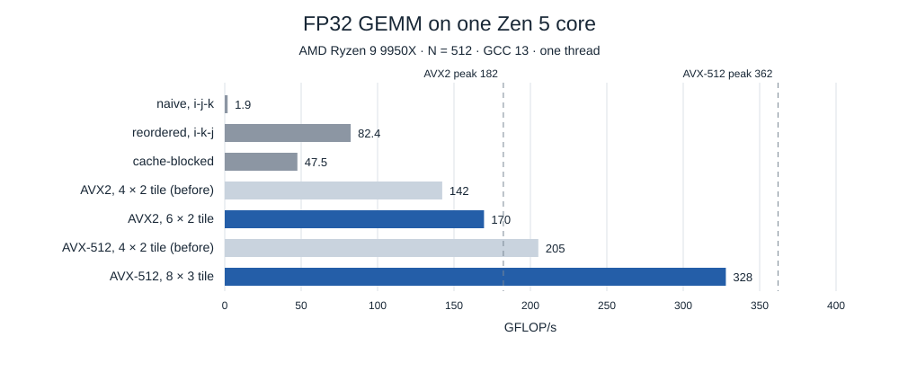
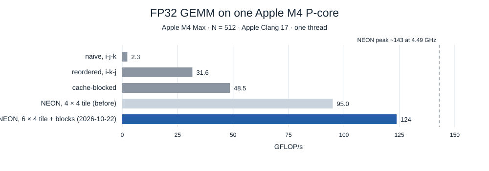

# Matrix multiplication with SIMD on Apple M4 and AMD Zen 5: from 0.4 to 333 GFLOP/s on one core

*One thread on an Apple M4 Max P-core and an AMD Ryzen 9 9950X (Zen 5)
core. Every number was measured on those machines; the code is in
[hpc-math-core](https://github.com/vdeviatkov/hpc-math-core). Part 1 of a
series: [part 2](sme2-gemm.md) moves the same multiplication to Apple's
matrix unit, [part 4](cuda-gemm.md) to an NVIDIA GPU.*

Matrix multiplication, C = A · B, is the operation the rest of this series
optimises on ever more specialised hardware. Before matrix units and GPUs,
there is the ordinary CPU core: vector registers and fused multiply-add
(FMA) instructions. This article takes the textbook triple loop to 92% of
what a Zen 5 core can compute, measures every step on two quite different
cores, and isolates the three things that decide the result:
which loop runs innermost, which data stays in cache, and how many
independent accumulators the inner loop keeps in registers.

**Key results**

- The textbook i-j-k loop runs at **0.4–0.6 GFLOP/s** at N = 4096: it
  touches a new cache line of B for every multiply-add. Changing the loop
  order to i-k-j is **25–73× faster**, with no other change.
- The peak is set by the FMA units: measured, **362 GFLOP/s FP32 on a
  Zen 5 core (AVX-512)** and **~130 on an M4 P-core (NEON)**. To reach it a
  kernel needs FMA latency × FMA pipes independent accumulators: 8–12 on
  Zen 5, 12–16 on M4.
- An AVX-512 register tile with 8 accumulators ran at **60% of peak**
  because GCC folded the B loads into the FMAs, re-loading B for every FMA.
  An 8-row tile with 16 accumulators loads B once per step: **333 GFLOP/s,
  92% of peak** (+53%). The same change made the M4's FP64 kernel 26–38%
  faster for N ≥ 256.

## The problem

For N × N matrices, C(i,j) = Σₖ A(i,k) · B(k,j) costs N³ multiply-adds,
2N³ flops: 137 Gflop at N = 4096. Each element of A and B is used N times,
so the arithmetic is not the hard part; feeding it is. Matrices here are
row-major: element (i,j) is at offset i·N + j, so a row is contiguous and a
column is N elements apart.

## The machines, measured

| One core | Apple M4 Max P-core (12 P + 4 E cores) | AMD Ryzen 9 9950X (Zen 5, 16 cores) |
|---|---|---|
| Clock, measured under load | 3.96–4.13 GHz | 5.71 GHz |
| Vector registers | 32 × 128-bit (4 FP32) | 32 × 512-bit (16 FP32) with AVX-512 |
| L1 data cache | 128 KiB, 128-byte lines | 48 KiB, 64-byte lines |
| L2 cache | 16 MiB, shared by 6 cores | 1 MiB, private |
| Last-level cache | system-level cache, shared by the chip | L3, 32 MiB per 8 cores |
| FMA latency, measured | ~3.3 cycles | 4.0 cycles |
| FMAs per cycle, measured | up to ~4 | 2 |
| FP32 peak | ~130 GFLOP/s | **362 GFLOP/s** (AVX2: 182) |
| FP64 peak | ~65 GFLOP/s | 180 GFLOP/s (AVX2: 91) |

The clock is measured with a chain of dependent integer adds, one per cycle
on both cores. The M4 clock moves with the load on the other cores:
3.94–3.99 GHz in part 2's measurements, 3.96–4.13 GHz here. Cache sizes
and line lengths are what the operating systems report (`sysctl hw` on
macOS, `lscpu` on Linux). FMA latency and throughput come from `fma_peak`, a loop of
FMAs on C independent register accumulators and no memory traffic. With
one accumulator each FMA waits for the previous one; with more, they
overlap until the FMA pipes are full:

| FMAs per cycle (FP32) | 1 | 2 | 4 | 8 | 12 | 16 |
|---|--:|--:|--:|--:|--:|--:|
| Zen 5, AVX-512 | 0.25 | 0.50 | 1.00 | 1.83 | **1.98** | 1.98 |
| M4, NEON | 0.30 | 0.58 | 1.22 | 2.01 | 2.81 | **3.46** |

Zen 5 retires two 512-bit FMAs per cycle with a latency of exactly 4
cycles: 8 accumulators come close and 12 reach the full rate. The M4 core
has four 128-bit FMA pipes and a shorter latency, ~3.3 cycles; it needs
16 accumulators to come near its peak (3.97 FMAs per cycle measured in
FP64 with 20). The two cores do the same work per cycle by different
means: Zen 5 with wide vectors, M4 with more of them.

That rule, **accumulators ≥ latency × pipes**, decides the design of every
fast kernel below, and of the SME2 and GPU kernels in the rest of the
series.

## Step 1: the textbook loop — 0.4 GFLOP/s

```cpp
for (i = 0; i < N; ++i)
    for (j = 0; j < N; ++j) {
        float acc = 0;
        for (k = 0; k < N; ++k)
            acc += A[i*N + k] * B[k*N + j];   // B walks down a column
        C[i*N + j] = acc;
    }
```

The inner loop reads A along a row, which is contiguous, and B down a
column, N elements apart. Every B(k,j) is on a different cache line, and
the line holding B(k,j) is needed again for B(k,j+1) only after the loop
has touched N other lines: 256 KiB at N = 4096 on Zen 5, 512 KiB on M4,
more than either L1. Each multiply-add waits for a cache miss.

| GFLOP/s, FP32 | N = 64 | 256 | 1024 | 4096 |
|---|--:|--:|--:|--:|
| Zen 5 | 15.8 | 3.4 | 0.57 | 0.42 |
| M4 | 8.9 | 2.5 | 2.1 | 0.59 |

At N = 64 the whole problem fits in L1 and the loop is merely slow; from
there it collapses. At N = 4096 one FP32 multiplication takes about 328 s
on Zen 5 (312 s for FP64), and FP32 and FP64 run at the same speed (0.42
and 0.44 GFLOP/s): element width does not matter to a loop that waits on
memory. Vector instructions do not rescue it either: the AVX2, AVX-512 and
NEON versions of this loop gather B's column into a vector element by
element; they help at mid sizes (NEON: 3.5 against 2.5 GFLOP/s at
N = 256), but at N = 4096 run within a few percent of the scalar loop.

## Step 2: loop order — 25–73× faster

Swapping the two inner loops makes the innermost loop walk rows
(C must be zeroed before this accumulation loop):

```cpp
for (i = 0; i < N; ++i)
    for (k = 0; k < N; ++k) {
        const float a = A[i*N + k];                // fixed for the whole j loop
        for (j = 0; j < N; ++j)
            C[i*N + j] += a * B[k*N + j];          // B and C: contiguous rows
    }
```

B and C are now read along rows, every byte of every cache line is used,
the hardware prefetcher can run ahead, and the compiler vectorises the
inner loop by itself (both compilers, at `-O3`):

| GFLOP/s, FP32 | N = 64 | 256 | 1024 | 4096 | ×naive at 4096 |
|---|--:|--:|--:|--:|--:|
| Zen 5 | 50.4 | 93.9 | 70.2 | 30.5 | 73× |
| M4 | 82.6 | 31.0 | 31.6 | 30.7 | 52× |

Two limits remain. Each multiply-add now also loads and stores an element
of C, so the loop moves three values per FMA; on the M4 it sits at about
one 128-bit FMA per cycle from N = 256 on. And for large N, a row of C and
the whole of B no longer stay cached between uses: at N = 4096 the k loop
streams all of B (64 MiB) from memory again for every row of A, and Zen 5
falls to 30 GFLOP/s.

## Step 3: cache blocking

Tiling the three loops into 64 × 64 blocks keeps the working set of the
inner loops at 3 × 64 × 64 elements (48 KiB in FP32) whatever N is, so each
tile of B is reused from cache by 64 rows of A:

| GFLOP/s, FP32 | N = 64 | 256 | 1024 | 4096 |
|---|--:|--:|--:|--:|
| Zen 5 | 48.9 | 47.8 | 46.0 | **42.5** |
| M4 | 83.0 | 80.5 | 41.1 | 28.8 |

On Zen 5 throughput is now flat, 1.4× the reordered loop at N = 4096, but
at N = 256 it is half the reordered loop's speed: 64-element inner loops
leave the auto-vectoriser less to work with than full rows. On the M4 it
is fast up to N = 256 and then decays, to below the reordered loop at
N = 4096; its 64 rows of each B tile are N elements apart, the access
pattern the last section of this article measures. Either way the inner
loop is unchanged: a load, an FMA and a store of C per vector.

## Step 4: a register tile

The step that matters keeps a block of C in **registers** for the whole k
loop. The kernel computes, say, 8 rows × 32 columns of C at once. At each
k it loads 32 consecutive values of row k of B as two vectors, broadcasts
the 8 values A(i..i+7, k), and adds their outer product into 16 vector
accumulators:

```cpp
// AVX-512, FP32: an 8 × 32 block of C in 16 ZMM registers
for (k = 0; k < kc; ++k) {
    const __m512 b0 = _mm512_loadu_ps(B + k*ldb);         // B(k, j .. j+15)
    const __m512 b1 = _mm512_loadu_ps(B + k*ldb + 16);    // B(k, j+16 .. j+31)
    for (int r = 0; r < 8; ++r) {                         // unrolled
        const __m512 a = _mm512_set1_ps(A[r*lda + k]);    // broadcast A(i+r, k)
        acc[r][0] = _mm512_fmadd_ps(a, b0, acc[r][0]);
        acc[r][1] = _mm512_fmadd_ps(a, b1, acc[r][1]);
    }
}
```

Per k step: 2 vector loads and 8 broadcasts for 16 FMAs, against a load,
a store and a load per FMA in step 2. C is loaded once before the loop and
stored once after it, every kc = 256 steps. Around the micro-kernel, a
three-level blocking like step 3's (64 rows × 256 k × 256 or, for AVX-512,
512 columns) keeps the A and B blocks in cache. The tiles used:

| Kernel | Register tile of C | Accumulators | Registers used |
|---|---|--:|--:|
| NEON, FP32 | 4 × 16 (4 rows × 4 vectors) | 16 | 24 of 32 |
| NEON, FP64 | 8 × 4 (8 rows × 2 vectors) | 16 | 19 of 32 |
| AVX2, FP32 / FP64 | 4 × 16 / 4 × 8 (4 rows × 2 vectors) | 8 | 11–14 of 16 |
| AVX-512, FP32 / FP64 | 8 × 32 / 8 × 16 (8 rows × 2 vectors) | 16 | 19 of 32 |

This is an outer product computed with vector FMAs: 8 values of A times
32 values of B, 256 multiply-adds per k step. Part 2 of this series runs
the same idea on a unit that performs a 16 × 16 outer product in a single
instruction.

### Why the tile has 8 rows: a code-generation trap

The AVX-512 kernel first had a 4 × 2 tile, 8 accumulators, which the FMA
measurement says is enough for 92% of peak. It ran at 60%. To find out
why, `simd_microkernel` runs the micro-kernel alone on data that stays in
L1, varying the number of rows:

| Zen 5, AVX-512 FP32, L1-resident | Accumulators | GFLOP/s | % of peak |
|---|--:|--:|--:|
| 4 rows × 2 vectors | 8 | 143.7 | 40% |
| 6 rows × 2 vectors | 12 | 348.5 | 96% |
| 8 rows × 2 vectors | 16 | **352.4** | **97%** |
| 12 rows × 2 vectors | 24 | 353.2 | 98% |

The 4-row kernel is far slower than its accumulators allow, and the machine
code shows why. For 4 rows, GCC 13 folds the loads of B into the FMAs as
memory operands:

```text
vfmadd231ps  (%rdx),%zmm11,%zmm2       # B(k, j..j+15) loaded again
vfmadd132ps  0x40(%rdx),%zmm7,%zmm11   # B(k, j+16..j+31) loaded again
vfmadd231ps  (%rdx),%zmm10,%zmm1       # … and again for every row
```

Every FMA re-loads its vector of B: 8 loads of B plus 4 broadcasts per k
step for 8 FMAs, 12 loads where 6 suffice. Zen 5 performs at most two
512-bit loads per cycle (AMD's documented limit, not measured here), so
such a k step cannot take fewer than 6 cycles,
while its 8 FMAs need 4. Measured, it takes 10.2 cycles in isolation and
6.7 in the library kernel: the loads, not the FMA units, set the pace. With
6 or more rows the compiler loads B into registers once per k step (4 loads
per two steps) and every FMA is register-only.

The library kernel was changed to the 8-row tile, which also divides its
64-row block evenly. In the full multiplication, same session:

| `gemm_avx512_blocked`, GFLOP/s | N = 256 | 512 | 1024 | 4096 |
|---|--:|--:|--:|--:|
| FP32, 4 × 2 tile | 216.8 | 205.2 | 141.3 | 119.9 |
| FP32, 8 × 2 tile | **332.7** | **327.9** | **284.6** | **198.2** |
| FP64, 4 × 2 tile | 106.2 | 55.8 | 55.1 | 51.1 |
| FP64, 8 × 2 tile | **161.5** | **105.2** | **90.9** | **77.2** |

The NEON FP64 kernel had the opposite problem: no folding, but only 8
accumulators for a core that needs 12–16. On L1-resident data, 8 rows
instead of 4 nearly doubled it (31.0 → 58.2 GFLOP/s); in the full
multiplication it is 26–38% faster from N = 256 up (31.5 → 39.6 GFLOP/s at
N = 256, 24.0 → 33.1 at N = 4096) and unchanged at N = 64 (38.2 → 37.3). The FP32 NEON kernel already had 16 accumulators; 20 would add
5%. The AVX2 kernel keeps its 4 × 2 tile at 83% of the AVX2 peak: a 6-row
tile is 15% faster in isolation, but needs 15 of AVX2's 16 registers and
does not divide the 64-row block.

### What the register tile reaches

| GFLOP/s, FP32 | N = 64 | 256 | 512 | 1024 | 4096 |
|---|--:|--:|--:|--:|--:|
| Zen 5, AVX-512 | 320.3 | **332.7** | 327.9 | 284.6 | 198.2 |
| Zen 5, AVX2 | 151.2 | 150.2 | 143.4 | 93.5 | 75.9 |
| M4, NEON | 93.5 | 94.4 | **95.0** | 91.2 | 69.8 |

| GFLOP/s, FP64 | N = 64 | 256 | 512 | 1024 | 4096 |
|---|--:|--:|--:|--:|--:|
| Zen 5, AVX-512 | 154.6 | **161.5** | 105.2 | 90.9 | 77.2 |
| Zen 5, AVX2 | 75.1 | 71.3 | 46.0 | 41.7 | 37.3 |
| M4, NEON | 37.3 | **39.6** | 39.2 | 37.9 | 33.1 |





At its best size the AVX-512 kernel runs at **92% of the core's FP32 peak
and 90% of FP64**, AVX2 at 83% / 82%, NEON at 73% / 61%. Against the
textbook loop at N = 4096 the AVX-512 kernel is 474× faster in FP32.

## What remains: B's row stride

All the register-tile kernels lose throughput as N grows, and the drops
line up with the byte distance between B's rows, which these kernels read
in place: the AVX-512 kernel drops at FP32 N = 1024 and FP64 N = 512, both
a 4 KiB stride. The micro-kernel runs down 256 rows of B, and rows a power
of two apart compete for a few cache sets. The micro-kernel experiment
measures it directly, on data small enough for L1:

| AVX-512 FP32, 16 accumulators, L1-resident | GFLOP/s |
|---|--:|
| B packed (rows contiguous) | 352.4 |
| B rows 1 KiB apart | 335.6 (−5%) |
| B rows 4 KiB apart | 275.5 (−22%) |

The full kernel drops at the same sizes, by less: −13%, 327.9 → 284.6
FP32 from N = 512 to 1024, where B's stride is one cost among several. The cure is to copy each strip of B into a
contiguous buffer before the micro-kernel uses it. Part 2 does exactly
that for the SME2 kernel, and part 3 measures this kind of conflict in
detail.

## What does not help

- **Wider vectors on a memory-bound loop.** Explicit AVX2, AVX-512 and
  NEON versions of the reordered loop run at or below the speed of the
  scalar one, which the compiler already vectorises; vector versions of
  the textbook loop gain at mid sizes and nothing at N = 4096.
- **Software prefetch.** Prefetching A, B and C 2 to 16 tile rows ahead of
  the current register-tile kernels changes their throughput by −3% to
  +1% (Zen 5, AVX-512) and −2% to +2% (M4, NEON) at N = 256 to 1024: the
  hardware prefetchers already follow these streaming patterns. On the
  earlier 4-row AVX-512 kernel, which was bound by its loads, prefetching
  gained up to 6%, and 21% in one outlier (FP64, N = 512, 16 rows ahead).

## Correctness

Every kernel is compared element by element with the textbook loop on 32
shapes in FP32 and FP64
([`tests/test_gemm.cpp`](https://github.com/vdeviatkov/hpc-math-core/blob/main/tests/test_gemm.cpp)):
squares around every vector and tile width (1–5, 7, 8, 13, 15–17, 31–33,
64, 100, 128, 256), rectangles with partial tiles in every dimension, and
empty matrices. Row counts such as 17, 33, 63, 129 and 257 exercise the
scalar tails of the 4- and 8-row tiles. An element passes if
`|C − C_ref| ≤ tol · (1 + |C_ref|)`, tol = 1e-4 in FP32 and 1e-10 in FP64:
the kernels sum in a different order than the reference, and the tests use
the same `-ffast-math` build as the benchmarks. All pass on both machines,
before and after the tile changes.

## Limitations

- **One thread.** Both chips have 16 cores; this article is about what one
  core's vector units do.
- **Two compilers, one version each.** The folding of B loads into FMAs is
  GCC 13's choice for this loop; another compiler or version may choose
  differently, which is why the kernel now uses a tile that is fast either
  way.
- **The M4 ran with background load.** Two unrelated processes kept two
  cores busy during the M4 measurements; the core clock moved between 3.96
  and 4.13 GHz from one program to the next. Treat M4 figures as ±5%.
- **No hardware counters on the CPUs.** macOS exposes none to user code,
  and the Linux machine restricts them. The explanations rest on controlled
  experiments and on reading the generated machine code.

## Takeaways

1. **Loop order before everything.** The same arithmetic in the order that
   walks rows is up to 73× faster.
2. **Measure the FMA units, then count accumulators.** Latency × pipes is
   the minimum number of independent accumulators: 8–12 on Zen 5, 12–16 on
   M4. Below that a kernel cannot reach peak, whatever else is right.
3. **Read the machine code.** The AVX-512 kernel had enough accumulators on
   paper; the compiler's choice to re-load B in every FMA held it at 60%.
   A larger tile fixed it: 92% of peak.
4. **The register tile is an outer product.** Every fast kernel in this
   series keeps a block of C in registers (or, on a matrix unit, in
   accumulator tiles) and adds outer products of a column of A and a row of
   B into it.

**Next:** [part 2](sme2-gemm.md) runs the same multiplication on Apple's
SME2 matrix unit, where one instruction is a 16 × 16 outer product, and
packs B to remove the stride problem above.

## Reproduce

```bash
git clone https://github.com/vdeviatkov/hpc-math-core && cd hpc-math-core
cmake -B build -DCMAKE_BUILD_TYPE=Release          # add -DHPC_ENABLE_AVX512=ON on x86
cmake --build build --parallel
ctest --test-dir build
./build/benchmarks/fma_peak                        # FMA latency and throughput
./build/benchmarks/simd_microkernel                # the micro-kernel alone
./build/benchmarks/bench_gemm --benchmark_filter='^(Naive|Reordered|Blocked|Neon|Avx2|Avx512)'
```

The kernels are in
[`src/gemm/`](https://github.com/vdeviatkov/hpc-math-core/tree/main/src/gemm)
(`naive.hpp`, `reordered.hpp`, `blocked.hpp`, `neon.hpp`, `avx2.hpp`,
`avx512.hpp`). Raw data and method:
[experiments/cpu-simd](https://github.com/vdeviatkov/hpc-math-core/tree/main/docs/experiments/cpu-simd).
