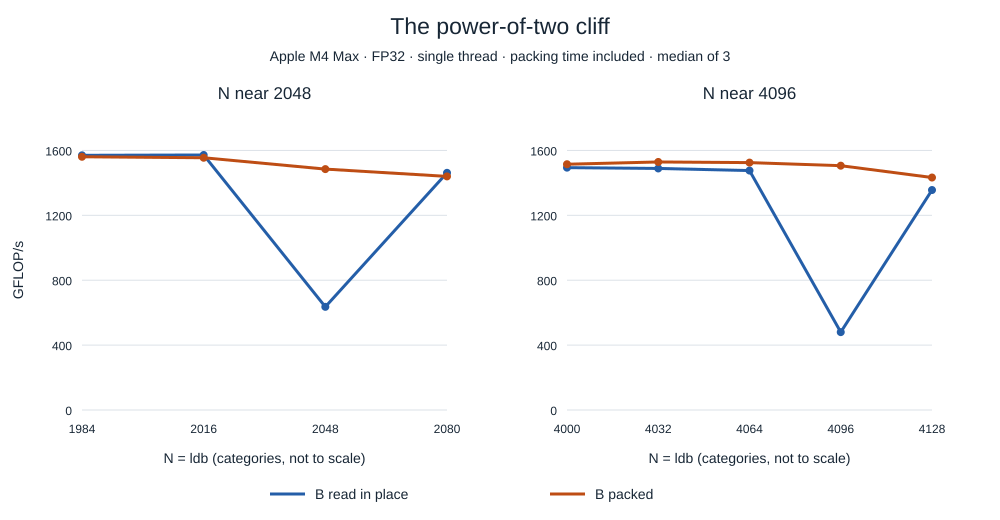
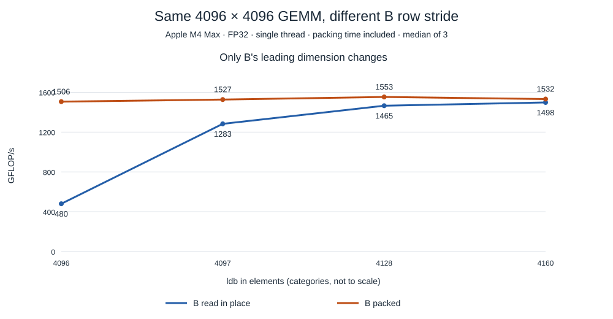
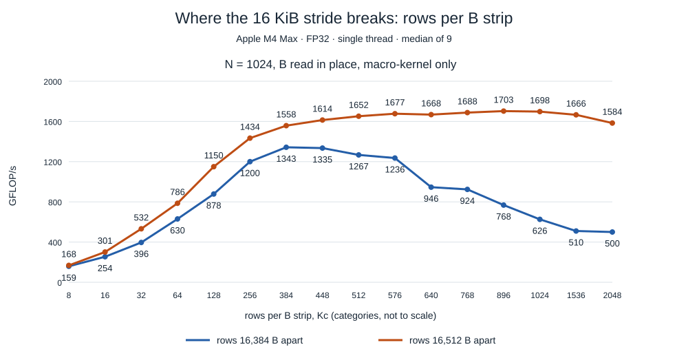

# A power-of-two stride halves SME2 GEMM throughput on Apple M4

*Apple M4 Max, one thread, FP32. How the kernel is built, and the
machine's caches, TLBs and SME unit:
[Matrix multiplication on Apple M4's SME2 unit](sme2-gemm.md).*

A matrix multiplication written for ARM's Scalable Matrix Extension (SME2)
reached **1,494 GFLOP/s at N = 4000 and 480 GFLOP/s at N = 4096**. The larger
problem does 7% more work, and its throughput drops by 68%. This article traces that
cliff to its cause and measures both fixes.

**Key results**

- The slowdown follows the **byte distance between rows of B**, not the
  matrix size: keeping N = 4096 and padding each row of B by 128 bytes
  restores 3.1× throughput with the same arithmetic.
- At a 16 KiB row stride, the B rows the kernel reuses compete for a small
  part of the cache. The kernel collapses between 576 and 640 rows per
  reused strip, far past the 8 rows an L1 set can hold, and the CPU core's
  own loads hit the same limit: the evidence points to **L2 set
  conflicts**.
- **Packing B** into contiguous strips removes the cliff for any stride. It
  costs about 3% of the runtime and cuts compute time by 8–9% even when
  the stride is already padded.

## The kernel and the B operand

The kernel computes `C = A × B` for row-major matrices. SME's `FMOPA`
instruction adds the outer product of two vectors into ZA, a 2-D
accumulator. With M4's 512-bit streaming vector length (16 FP32 lanes), ZA
holds four 16 × 16 FP32 tiles, which together accumulate a 32 × 32 block
of C:

```text
for k in 0 .. Kc-1:
    a = A[i .. i+31, k]                  // column segment of A: 2 vectors
    b = B[k, j .. j+31]                  // row segment of B: 2 vectors, one svld1_x2
    C[i .. i+31, j .. j+31] += a ⊗ b     // 4 FMOPAs, one per ZA tile
```

A's 32 values are a row apart and streaming mode has no gather load, so A
is always packed into strips where each column segment is contiguous. B's
32 values are already adjacent, so B can be read **in place**: row `k` of
the segment is at `B + k·ldb + j`. Or B can be **packed**: each 32-column
strip of a `Kc`-row block is copied into a contiguous buffer, 128 bytes per
row.

Both variants run one driver, `sme_detail::blocked_driver<float, PackB>`
([source](https://github.com/vdeviatkov/hpc-math-core/blob/main/src/gemm/sme.hpp)),
with GotoBLAS cache blocking `Mc = 1024`, `Kc = 2048`, `Nc = 4096`. Only the
B source differs:

| | B in place | B packed |
|---|---|---|
| A packing, blocking, ZA tiles, FMOPAs | identical | identical |
| Row k of a B strip | `B + k·ldb + j` | `strip + k·128 B` |
| Cost of copying B | none | included in every timing |

The quantity that matters is the **B strip**: 2,048 rows × 32 floats =
256 KiB. The macro-kernel streams one strip against the 32 A strips of an
Mc block, one after another, so the strip must stay cached between those
32 passes. Packed, the strip is 256 KiB of contiguous memory. In place at
`ldb = 4096`, it is 2,048 pieces of 128 bytes spaced 16 KiB apart, spread
over 32 MiB of address space.

## N = 4096 runs at half the speed of N = 4000

Square matrices around 2048 and 4096, so the row stride is `N × 4` bytes.
Median of 3 interleaved repetitions; each timed call includes scratch
allocation and all packing.



| N | B row stride | B in place, GFLOP/s | B packed, GFLOP/s |
|---:|---:|---:|---:|
| 1984 | 7,936 B | 1,570 | 1,561 |
| 2016 | 8,064 B | 1,572 | 1,555 |
| **2048** | **8,192 B** | **636** | 1,485 |
| 2080 | 8,320 B | 1,462 | 1,440 |
| 4000 | 16,000 B | 1,494 | 1,515 |
| 4032 | 16,128 B | 1,489 | 1,529 |
| 4064 | 16,256 B | 1,476 | 1,525 |
| **4096** | **16,384 B** | **480** | 1,506 |
| 4128 | 16,512 B | 1,356 | 1,433 |

The dips sit exactly on the powers of two: −60% at 2048 and −68% at 4096
against the size just below, with recovery 32 columns either side. Packed
B shows no cliff at all.

## Same multiplication, different stride: the cliff follows the bytes

Changing N also changes the work and the memory footprint. The decisive
test fixes `M = N = K = 4096` and stores B in a wider buffer, so only the
row stride `ldb` changes. The padding columns are never read.



| ldb | B row stride | B in place, GFLOP/s | B packed, GFLOP/s |
|---:|---:|---:|---:|
| **4096** | **16,384 B** | **480** | 1,506 |
| 4097 | 16,388 B | 1,283 | 1,527 |
| 4128 | 16,512 B | 1,465 | 1,553 |
| 4160 | 16,640 B | 1,498 | 1,532 |

One extra cache line per row (`ldb = 4128`) makes B 0.5 MiB larger and the
in-place kernel **3.1× faster**. The arithmetic, the useful data and the
number of 16 KiB pages touched are unchanged; only the stride moved.
`ldb = 4097` recovers less because its 128-byte row segments no longer
start on a cache-line boundary, so each one spans two lines.

## Why 16 KiB is special: rows competing for one cache set

A set-associative cache stores each line in one set chosen from its
address, and each set holds a fixed number of lines (its ways). In the
simplest scheme, modulo indexing, the set is taken directly from the
address bits just above the line offset: with 128-byte lines and 128
sets, a line's set is its line number modulo 128. In such a cache (an
illustrative model, not Apple's documented L2 mapping), the rows of one B
strip land like this:

```text
B in place, rows 16 KiB apart          B packed, rows 128 B apart
(16,384 B = 128 lines per row)         (one line per row)

  row 0     ──►  set 0                   row 0     ──►  set 0
  row 1     ──►  set 0                   row 1     ──►  set 1
  row 2     ──►  set 0                   row 2     ──►  set 2
  row 3     ──►  set 0                   row 3     ──►  set 3
   …                                      …
  row 2047  ──►  set 0                   row 2047  ──►  set 127

  2,048 rows share one set's ways        16 rows per set, every set used
```

Every in-place row starts exactly 128 lines after the previous one, so in
this model all of them compete for the few ways of a single set, while
the rest of the cache stays unused. Packed rows walk through the sets one
by one. Padding B by one line per row (16,512 B, 129 lines) also spreads
the rows: each one moves one set further.

More generally, rows `s` bytes apart, with `s` a multiple of the 128-byte
line, step through the sets `s / 128` at a time and so occupy only
`S / gcd(s / 128, S)` of a cache's `S` sets. For a modulo-indexed cache
with 128 sets:

| Row stride | Stride in lines | Sets the strip's rows use |
|---:|---:|---:|
| 16,384 B | 128 | 1 |
| 8,192 B | 64 | 2 |
| 16,000 B | 125 | all 128 |
| 16,512 B | 129 | all 128 |
| 128 B (packed) | 1 | all 128 |

At a power-of-two stride every row of the strip lands in the same few sets.
Once the strip has more rows than those sets have ways, it evicts itself
before the next A strip comes back for it: **conflict misses** in a cache
that has plenty of total capacity. One line more of stride spreads the rows
over every set, which matches what the padding experiment shows. An
8 KiB stride gives the rows twice as many sets as 16 KiB, but a
2,048-row strip overflows those too, which is consistent with N = 2048
losing almost as much as N = 4096.

This calculation illustrates the conflict mechanism for a conventional
modulo-indexed cache. Modern processors can instead hash higher address
bits into the set index, and Apple does not document the set-indexing
function of M4's L2. The table is therefore a model of the mechanism, not
a reconstruction of the M4 Max's physical cache organization. The evidence
for conflicts on this machine is the controlled stride and working-set
experiments: the padding test above and the capacity measurements below.

## Locating the conflicts: L2, not L1

Which cache? The number of rows a strip can have before the conflict bites
measures the capacity of the conflicting sets, so the next experiment
varies the strip height `Kc` while timing only the macro-kernel (A packed
and B laid out once, N = 1024, Mc = 1024, 9 shuffled repetitions).



| Rows per strip | rows 16,384 B apart | rows 16,512 B apart | ratio |
|---:|---:|---:|---:|
| 64 | 630 | 786 | 0.80 |
| 256 | 1,200 | 1,434 | 0.84 |
| 512 | 1,267 | 1,652 | 0.77 |
| 576 | 1,236 | 1,677 | 0.74 |
| **640** | **946** | 1,668 | **0.57** |
| 1024 | 626 | 1,698 | 0.37 |
| 2048 | 500 | 1,584 | 0.32 |

Up to 576 rows the power-of-two stride costs 5–26%; between 576 and 640
rows it breaks, and from there it degrades with every row added, to a
third of the padded throughput at the 2,048 rows `gemm_sme` uses. An 8-way
L1 set would overflow at the 9th row. The conflicting structure holds
roughly 600 rows at this stride, a capacity on the scale of L2, not L1.

A pointer chase on a CPU core, one dependent load per line, confirms the
L2's capacity at this stride independently of SME (cycles per load at
3.99 GHz):

| Lines, 16 KiB apart | 8 | 16 | 448 | 512 | 768 | 1,024 | 2,048 |
|---|--:|--:|--:|--:|--:|--:|--:|
| cycles per load | 3 | 24 | 33 | 41 | 52 | 100 | 144 |

Only 8 lines stay in L1 (3 cycles); roughly 450–600 stay in L2 (~32
cycles; the step moved between 448 and 640 lines across three runs);
beyond that, loads go further out. The SME kernel breaks in the same
range, between 576 and 640 rows. The two measurements agree on the
structure: a power-of-two stride leaves this data a few hundred lines of a
131,072-line L2.

What this does and does not prove: the matching capacity thresholds, in
two independent experiments, strongly suggest that L2 conflicts cause the
throughput collapse. Neither measurement reveals individual cache-set
mappings, and neither replaces hardware performance counters; what they
establish is a capacity scale consistent with L2 rather than L1. The
mechanism is inferred from controlled measurements, not observed
directly.

## Fix 1: pad the leading dimension

Padding B's rows by one cache line removes the cliff: 480 → 1,465 GFLOP/s
at N = 4096. It costs 0.8% more memory and no code. It is not a complete
fix, for two reasons:

- The caller owns B's layout. A library receiving a matrix with a 16 KiB
  stride cannot pad it without copying it, and a copy is what packing is.
- Even padded, B in place trails packed B by 4–8%, more for wider
  matrices. Macro-kernel only, `ldb = N + 32`:

| N | 1024 | 2048 | 3072 | 3584 | 4096 | 4224 |
|---|--:|--:|--:|--:|--:|--:|
| in place / packed | 0.96 | 0.95 | 0.92 | 0.92 | 0.92 | 0.92 |

## Fix 2: pack B, and why it wins

Packing copies each strip once per `Kc` block and lets every reuse read a
contiguous 128-byte stream, whatever the caller's stride. The cost is
measurable directly: the same driver with a clock around each phase, N =
4096, 15 shuffled repetitions, medians in milliseconds.

| ldb | B | End to end | Pack A | Pack B | Compute |
|---:|:--|--:|--:|--:|--:|
| 4096 | in place | 281.2 | 3.75 | — | 278.9 |
| 4096 | packed | 91.1 | 3.84 | 4.94 | 82.4 |
| 4128 | in place | 92.9 | 3.74 | — | 89.0 |
| 4128 | packed | 88.5 | 3.76 | 2.54 | 82.0 |
| 4160 | in place | 93.2 | 3.77 | — | 89.6 |
| 4160 | packed | 88.4 | 3.81 | 2.49 | 81.7 |

- At the 16 KiB stride, packing costs 4.9 ms and saves 196 ms of compute.
- With an already padded stride, packing costs 2.5 ms and still saves
  7–8 ms; packed B was faster in all 15 repetitions.
- With packed B, compute time is the same 82 ms for every `ldb`: the
  macro-kernel only ever sees the packed layout.

The copy is cheap because each element of B is copied once, while the
compute reads it once per A strip: 32 times per A block, `M / 32` times in
all. At these sizes it pays for
itself several times over.

## Limitations

The experiments support the conclusions above strongly, which is a reason
to be precise about what they do not establish:

- **The L2 mapping and replacement policy are not established.** The
  set-index function, the number of ways, and how lines are chosen for
  eviction are undocumented, and nothing here measures them. The cache
  model above explains the mechanism; it does not describe M4's L2.
- **One machine.** All results come from one M4 Max system, under the
  load conditions recorded with the data. Other Apple chips, or other M4
  variants, may break at different thresholds.
- **One kernel configuration.** The thresholds belong to these matrix
  shapes, this micro-kernel and these block sizes. With the earlier
  blocking (Mc = 128, Kc = 1024) the kernel broke between 384 and 448
  rows instead of between 576 and 640; other shapes and blocks may move
  them again.
- **Inferred, not counted.** The case for L2 conflicts rests on throughput
  and latency thresholds matching across experiments. No hardware
  performance counters were read, so cache misses were not counted
  directly.

## Rules of thumb

1. **Look at strides in bytes, not dimensions.** A row stride that is a
   power of two of 8 KiB or more leaves few cache sets for all the rows a
   loop reuses. 4096 FP32 columns and 2048 FP64 columns are both 16 KiB.
2. **Test with a padded leading dimension.** Running the same problem with
   `ldb = N + one cache line` separates a stride effect from everything
   else in one measurement.
3. **Pack operands that are reused across a loop.** In a blocked GEMM the
   B strip is reused by every A strip; copying it into a contiguous buffer
   costs about 3% and makes performance independent of the caller's
   layout.
4. **Measure the conflicting capacity.** Sweeping the number of reused rows
   until the stride starts to hurt tells you which cache level is involved,
   without hardware counters.

## Method and reproduction

Apple M4 Max (P-cores: 128-byte lines, 128 KiB L1 data per core, 16 MiB L2
per cluster, 16 KiB pages), macOS 26.3.1, Apple Clang 17,
`-O3 -mcpu=apple-m4 -ffast-math -funroll-loops`, one thread. All results
are medians of repetitions run in randomly interleaved order on a desktop
machine under moderate load; interquartile ranges, raw samples, source
hashes and per-experiment details are in the
[experiment data](https://github.com/vdeviatkov/hpc-math-core/tree/main/docs/experiments/sme-b-stride).
Inputs are warm in cache between calls. GFLOP/s is `2·M·N·K` divided by
the time per call.

```bash
cmake -B build -DCMAKE_BUILD_TYPE=Release -DHPC_ENABLE_SME=ON
cmake --build build --parallel
ctest --test-dir build                       # includes every B layout used here

# size and padding sweeps
./build/benchmarks/bench_gemm --benchmark_filter=BStride/f32 \
    --benchmark_repetitions=3 --benchmark_enable_random_interleaving=true \
    --benchmark_report_aggregates_only=true
./build/benchmarks/sme_b_stride_probe height   # rows per strip
./build/benchmarks/sme_b_stride_probe width    # padded vs packed by width
./build/benchmarks/sme_b_layout 4096 15 3      # phase timing
./build/benchmarks/cache_chase                 # CPU core pointer chase
```

The chart data is in [sme2-bstride.csv](assets/sme2-bstride.csv) and the
experiment CSVs; [render_charts.py](assets/render_charts.py) regenerates the
three figures. The kernel is part of
[hpc-math-core](https://github.com/vdeviatkov/hpc-math-core), a set of GEMM
implementations from scalar C++ to SME2 and CUDA Tensor Cores.
