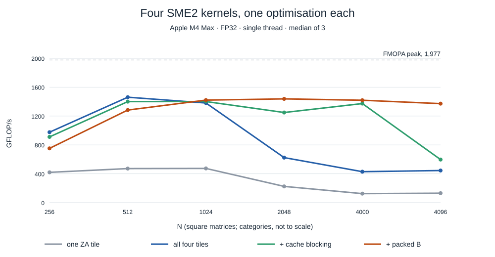

# Matrix multiplication on Apple M4's SME2 unit: from outer products to 1.5 TFLOP/s

*Apple M4 Max, one thread unless stated. Every number in this article was
measured on that machine; the code is in
[hpc-math-core](https://github.com/vdeviatkov/hpc-math-core).*

Apple's M4 is the first Apple chip that exposes its matrix unit through a
public instruction set: ARM's Scalable Matrix Extension, SME2. This article
builds a single-precision matrix multiplication (GEMM) for it from scratch
and measures what each design decision is worth, from the instruction up to
the caches and the TLB.

**Key results**

- The SME unit completes one 16 × 16 FP32 outer product (512 flops) per
  cycle, but each result takes 4 cycles to feed the next: **1.96 TFLOP/s
  peak, reachable only with four independent accumulators**. There is one
  unit per CPU cluster, not per core.
- Four steps take the kernel from **472 to 1,532 GFLOP/s** (78% of peak):
  use all four accumulator tiles (3.1×), block for the caches GotoBLAS-style
  with an 8 MiB A block resident in L2 (up to 3.4× at large N), and pack
  the B operand (up to 3.1× at power-of-two sizes).
- The result reaches 85–94% of Apple's own Accelerate library on the same
  core for N ≥ 1024 and beats Arm's KleidiAI micro-kernel at N = 4096
  (1,504 vs 1,019 GFLOP/s), because KleidiAI does no cache blocking.

## The machine

The test machine is a 16-core M4 Max: 12 performance cores in two clusters
of six, plus four efficiency cores. What macOS reports for a performance
core (`sysctl hw`), and what had to be measured:

| | Size | Load latency, cycles | Source |
|---|---|--:|---|
| P-core clock | 3.94–3.99 GHz | | measured |
| Cache line | 128 B | | sysctl |
| Page | 16 KiB | | sysctl |
| L1 data cache, per core | 128 KiB | 3 | sysctl, measured |
| L2 cache, per 6-core cluster | 16 MiB | 26–27 | sysctl, measured |
| System-level cache | | ~150 (32 MiB working set) | measured |
| DRAM | 64 GB | 380–440 | measured |
| First-level data TLB | 128 entries = 2 MiB | +14 on a miss | measured |
| Second-level TLB | 3,072 entries = 48 MiB | +39 for a page walk | measured |
| SME streaming vector length | 512 bits = 16 FP32 | | sysctl |

macOS reports neither the clock nor the TLBs, so both are measured. A
chain of dependent integer adds runs at exactly one add per cycle, which
gives the clock. Latencies come from a dependent pointer chase in random
order, which defeats the prefetcher. The TLB sizes come from the same chase
with one line per page, compared against the same lines packed densely:
latency rises from 136 pages on (128 entries) and jumps again between
3,072 and 3,328 pages. Method and raw data:
[machine measurements](https://github.com/vdeviatkov/hpc-math-core/tree/main/docs/experiments/sme2-machine).

### The SME unit

SME instructions do not run in the CPU core's own vector pipelines. They
run on a matrix unit shared by a cluster, which the core drives in a
separate *streaming mode*. A loop of outer-product instructions (`FMOPA`)
on constant inputs, with no memory traffic, measures it directly:

| | Accumulator tiles in use | Cycles per FMOPA | GFLOP/s |
|---|--:|--:|--:|
| FP32 (16 × 16 tile, 512 flops per FMOPA) | 1 | 4.09 | 494 |
| | 2 | 2.04 | 990 |
| | 4 | 1.03 | **1,963** |
| FP64 (8 × 8 tile, 128 flops per FMOPA) | 1 | 4.09 | 124 |
| | 4 | 1.01 | **500** |
| | 8 | 1.02 | 497 |

An FMOPA's result is ready for the next FMOPA on the same tile after
**4 cycles**, while the unit accepts **one new FMOPA per cycle**: 512 FP32
flops per cycle, 1.96 TFLOP/s at this clock. A kernel that
accumulates into a single tile therefore runs at a quarter of peak; four
independent tiles fill the pipeline. FP64 has the same issue rate with a
quarter of the work per instruction.

Running the same loop on several threads shows how the unit is shared:

| Threads | 1 | 2 | 4 | 6 | 8 | 12 |
|---|--:|--:|--:|--:|--:|--:|
| Total GFLOP/s | 1,963 | 1,954 | 2,830 | 3,912 | 4,007 | 4,203 |

Two threads that land on the same cluster get no more than one: they share
its SME unit. Spread across both performance clusters, the total
approaches twice the single-thread figure. One thread per cluster is all
SME can use.

## Outer products instead of dot products

A conventional SIMD GEMM computes C with vector FMAs: broadcast `A(i,k)`,
multiply it by a row segment of B, add into a row segment of C. Each FMA
instruction does 2 × lanes flops: 8 for NEON's 4 FP32 lanes.

SME computes an **outer product**. FMOPA takes a column vector `a` and a
row vector `b`, 16 FP32 values each, and adds every product `a[r]·b[c]`
into a 16 × 16 tile of ZA, a two-dimensional accumulator array:

```text
ZA[t][r][c] += a[r] * b[c]          for r, c in 0..15      (512 flops, one instruction)
```

With `a` taken from column `k` of A and `b` from row `k` of B, `K` such
instructions produce a 16 × 16 block of `C = A·B`. Two vectors loaded yield
256 multiply-adds, against 16 for an FMA on the same two vectors: the
outer product reuses every element 16 times inside the instruction. That
is why one core's SME unit does 64 times the work per instruction of its
NEON pipes.

ZA holds 64 × 64 bytes: four 16 × 16 FP32 tiles, or eight 8 × 8 FP64
tiles. The streaming mode imposes rules a kernel has to design around:

- **No gather loads.** A column of a row-major A is not contiguous, and
  streaming mode cannot gather it. A must be rearranged before the kernel
  reads it.
- **Mode switches cost.** Entering and leaving streaming mode (`smstart`,
  `smstop`) saves and restores state, so the switch belongs around large
  blocks of work, not inside loops.
- **ZA is shared state.** A function that uses ZA without declaring it
  makes the compiler save and restore ZA around every call (below, this
  costs 5×).

In C++, Clang's ACLE intrinsics express all of this:
`__arm_locally_streaming` makes a function enter and leave streaming mode,
`__arm_new("za")` gives it fresh ZA state, and `svmopa_za32_m(tile, pg, pg,
a, b)` is one FMOPA.

### What peak demands from memory

One step of the kernel developed below loads two A vectors and two B
vectors (256 bytes) and issues four FMOPAs (2,048 flops): 8 flops per
byte. At one FMOPA per cycle that is **64 bytes of operands every cycle**,
about 250 GB/s, from wherever the operands live. The rest of this article is about keeping that
traffic in a cache close enough to deliver it.

## Step 1: one accumulator tile — 472 GFLOP/s

The simplest SME GEMM accumulates each 16 × 16 block of C in one tile:

```text
for each 16-column block j of C:
    for each 16-row block i of C:
        zero tile 0
        for k in 0 .. K-1:
            a = A[i .. i+15, k]        // contiguous after packing A, see step 4
            b = B[k, j .. j+15]        // contiguous in row-major B
            FMOPA tile 0 += a ⊗ b
        store tile 0 to C[i .. i+15, j .. j+15]
```

It peaks at **472 GFLOP/s** (N = 512), 96% of the 494 GFLOP/s a single
dependent FMOPA chain allows: the kernel is entirely latency bound. Every
FMOPA waits for the previous one on the same tile, while three quarters of
the unit's issue slots stay empty.

## Step 2: all four tiles — 1,447 GFLOP/s

Four tiles accumulate a 32 × 32 block of C as a 2 × 2 grid of 16 × 16
tiles. Each step loads two A vectors and two B vectors and issues four
independent FMOPAs:

```cpp
for (std::int64_t k = 0; k < kc; ++k) {
    const auto a  = svld1_x2(pn, a_strip + k * mr);   // A rows 0-15 and 16-31, one instruction
    const auto b  = svld1_x2(pb0, b_strip + k * ldb); // B columns 0-15 and 16-31
    const auto a0 = svget2(a, 0), a1 = svget2(a, 1);
    mopa<T, 0>(pt, a0, svget2(b, 0));   // tile 0: C rows 0-15,  columns 0-15
    mopa<T, 1>(pt, a0, svget2(b, 1));   // tile 1: C rows 0-15,  columns 16-31
    mopa<T, 2>(pt, a1, svget2(b, 0));   // tile 2: C rows 16-31, columns 0-15
    mopa<T, 3>(pt, a1, svget2(b, 1));   // tile 3: C rows 16-31, columns 16-31
}
```

Four independent chains fill the FMOPA pipeline, and each loaded vector
now feeds two FMOPAs instead of one, halving the bytes per flop. SME2's
multi-vector load `svld1_x2` fetches two consecutive vectors in one
instruction. (A four-vector `svld1_x4`, loading two k steps at once,
measured within noise of it: the loop is limited by FMOPA issue and operand
delivery, not by load instructions.)

For FP64 the micro-tile is 2 × 4 tiles (16 × 32 elements, all eight FP64
tiles): eight FMOPAs per 384 bytes loaded instead of four per 256 bytes,
2.7 flops per byte instead of 2. That layout measured 9% faster than 2 × 2
at N = 4096.

| N | 256 | 512 | 1024 | 2048 | 4000 | 4096 |
|---|--:|--:|--:|--:|--:|--:|
| one tile, GFLOP/s | 420 | **472** | 464 | 220 | 125 | 131 |
| four tiles, GFLOP/s | 975 | **1,447** | 1,319 | 617 | 427 | 446 |



The gain is 2.3–3.4×, but from N = 2048 both kernels collapse. Without
blocking, every 32-column strip of B is streamed against all of A, so all
of A (16 MiB at N = 2048) is re-read once per strip and can no longer stay
in the 16 MiB L2. The kernel needs a structure that bounds what each loop
touches.

## Step 3: GotoBLAS blocking — 1,468 GFLOP/s at N = 4000

Kazushige Goto's design, used by GotoBLAS, OpenBLAS, BLIS and most vendor
libraries ([Goto and van de Geijn,
2008](https://dl.acm.org/doi/10.1145/1356052.1356053)), splits the
multiplication into blocks sized for each level of the memory hierarchy and
orders the loops so that each block is reused many times while it is
cached:

```text
for jc in 0 .. N step Nc:                  Nc = 4096 columns of B and C
  for pc in 0 .. K step Kc:                Kc = 2048
    B panel = B[pc .. pc+Kc, jc .. jc+Nc]  (32 MiB, FP32)
    for ic in 0 .. M step Mc:              Mc = 1024
      A block = A[ic .. ic+Mc, pc .. pc+Kc] (8 MiB)
      macro-kernel (streaming mode):
        for jr in 0 .. Nc step 32:         one B strip, Kc × 32 = 256 KiB
          for ir in 0 .. Mc step 32:       one A strip, 32 × Kc = 256 KiB
            load C[ic+ir .. +32, jc+jr .. +32] into ZA (or zero it when pc = 0)
            for k in 0 .. Kc-1:  4 FMOPAs  (the step-2 micro-kernel)
            store ZA to C
```

Each loop level fixes one operand while the levels inside it reuse it:

| Loop | Iterations at N = 4096 | Held fixed | Size | Reused by | Lives in |
|---|--:|---|--:|---|---|
| `k` | 2,048 | C micro-tile | 4 KiB | every k step | ZA |
| `ir` | 32 | B strip | 256 KiB = 16 pages | 32 A strips | L2 |
| `jr` | 128 | A block | 8 MiB = 512 pages | 128 B strips | L2 |
| `ic` | 4 | B panel | 32 MiB = 2,048 pages | 4 A blocks | system cache and DRAM |
| `pc` | 2 | (splits K) | | | |
| `jc` | 1 | (splits N) | | | |

The orders matter:

- **`k` innermost** keeps C in ZA for 2,048 steps; C crosses memory once per
  `pc` block instead of once per step.
- **`ir` inside `jr`**: a B strip is fetched from beyond L2 once and then
  read from L2 by 32 A strips in a row. An A strip is reused once per B
  strip, after the whole A block has passed through, so the A block must
  stay in L2: at 8 MiB, half of it, it does.
- **`ic` inside `pc`** means each B panel is packed once and serves every A
  block. A is the operand repacked more often: each element of A is packed
  `N / Nc` times, each element of B once.
- **Large `Kc`** amortises the round trip of C through ZA (once per `Kc`
  steps); **`Nc`** bounds the B panel. The panel does not fit in L2 and
  does not need to: only the current strip has to.

This is GotoBLAS's classic arrangement, A resident and B streamed, one
cache level further out. Classic GotoBLAS keeps the A block in L2 and
reuses each B micro-panel from L1. Here B strips are reused from L2,
because the SME unit is a cluster resource and its operands come from L2:
the [follow-up article](sme2-cache-associativity.md) shows SME loads
conflicting in L2 sets, at a capacity hundreds of times what one L1 set
holds.

The packing code that writes the blocks runs on the core, and its TLBs
cover them: a B strip (16 pages) fits the 128-entry first-level TLB, and
an A block (512 pages) and a B panel (2,048 pages) the 3,072-entry
second-level TLB.

| N | 256 | 512 | 1024 | 2048 | 4000 | 4096 |
|---|--:|--:|--:|--:|--:|--:|
| four tiles, GFLOP/s | 975 | 1,447 | 1,319 | 617 | 427 | 446 |
| + blocking, GFLOP/s | 989 | 1,460 | 1,333 | 633 | **1,468** | 489 |

Blocking holds throughput up at N = 4000 (3.4× over unblocked) but
leaves holes at exactly N = 2048 and N = 4096. That is the B layout, the
subject of the last step.

### Choosing the block sizes

The obvious alternative uses L2 the other way round: keep the **B panel**
resident and pass small A blocks through it. That was this kernel's first
sizing, Mc = 128 and Kc = 1024: a 16 MiB B panel, the whole L2, and
512 KiB A blocks. Each B strip was then reused by only 4 A strips before
the next one was needed, and the panel, which competes with A and C for
the same 16 MiB, kept partly falling out.

A sweep of the complete kernel (step 4 below) over Mc and Kc, N = 4096 and
Nc = 4096, median of 3 interleaved runs, shows where the optimum is:

| GFLOP/s by Mc (rows), Kc (depth) | Kc = 1024 | 2048 | 4096 |
|---|--:|--:|--:|
| Mc = 128 (first sizing) | 1,347 | | |
| 256 | 1,311 | 1,428 | 1,438 |
| 512 | 1,327 | 1,464 | 1,451 |
| 1024 | 1,370 | **1,517** | 1,351 |
| 2048 | 1,404 | 1,262 | 1,113 |

Throughput rises with the A block up to 8 MiB (Mc × Kc × 4 bytes:
1024 × 2048 or 512 × 4096) and falls once it reaches 16 MiB, the size of
L2, and beyond. Of the two 8 MiB shapes, 1024 × 2048 wins: with
Kc = 4096 each B strip is twice as long (512 KiB) and serves half as many
A strips (16). FP64 elements are twice as large, so FP64 uses Mc = 512
for the same 8 MiB A block. Against the first sizing, measured old and new
alternately, the complete kernel gains 4% at N = 2048 and 10–12% at
N = 4000 and 4096 in FP32 and up to 7% in FP64. At N = 256, where one
block covers the whole problem, it gains 10%; at N = 512–1024 it is
unchanged within noise.

The optimum also depends on the matrix size, so for each size there is a
best Mc, Kc and Nc, and a kernel can choose them per call from M, N and K.
The same sweep at each N, best sizes against the fixed choice:

| N | Best for this N (Mc, Kc, Nc) | GFLOP/s | Fixed (1024, 2048, 4096) | Gain |
|---|---|--:|--:|--:|
| 512 | 512, 1024, 2048 | 1,360 | 1,344 | +1.2% |
| 1024 | 512, 4096, 4096 | 1,435 | 1,400 | +2.5% |
| 2048 | 512, 4096, 2048 | 1,496 | 1,488 | +0.5% |
| 4096 | 1024, 2048, 4096 | 1,517 | 1,517 | — |

Below N = 4096 the winner has Mc = 512, a smaller A block than the
fixed choice. Tuning block sizes empirically is an established practice:
ATLAS, for example, searches them for each machine when it is installed.
For square matrices on this machine the per-size optimum buys at most
2.5% in FP32 and 1.3% in FP64, about the run-to-run noise, so `gemm_sme`
keeps one fixed set chosen for the large sizes, where blocking matters
most. The sweep covered square matrices only; strongly non-square shapes
may have optima further from the fixed set.

## Step 4: packing A and B — 1,532 GFLOP/s, no cliff

Both operands are copied into **strips**: narrow blocks laid out so that
each step of the micro-kernel reads one contiguous run of memory. This
section summarises why each operand needs them; part 2 of this series,
[*A power-of-two stride halves SME2 GEMM throughput*](sme2-cache-associativity.md),
takes the B strips apart in detail: how their rows map to cache sets, where
the conflicts happen, and what packing them costs and saves.

### Packing A: a transpose

FMOPA needs a 32-element column segment of A as one contiguous vector
pair. In row-major A those 32 values are a full row apart, and streaming
mode has no gather. So before the macro-kernel runs, each A block is
copied into **strips**: 32 rows of the block, stored column by column, so
step k of the micro-kernel reads 32 contiguous floats (128 bytes, one cache
line):

```text
strip[k * 32 + r] = A(i0 + r, pc + k)      r in 0..31, k in 0..Kc-1
```

The copy is a transpose. It is done with NEON 4 × 4 in-register
transposes (`vtrn1q_f32`, `vtrn2q_f32`, then swapping 64-bit halves with
`vcombine_f32`), which doubled packing bandwidth over a scalar loop and
made the whole GEMM about 10% faster. Packing runs before the macro-kernel
enters streaming mode, in the core's own NEON pipes; the SME unit only
ever sees packed data, and the mode switch happens once per 1024 × 2048 ×
4096 block.

### Packing B: control over the stride

B's 32-element row segments are already contiguous, so the kernel can read
B in place. But consecutive rows of a strip are then `N × 4` bytes apart:
16 KiB at N = 4096, 8 KiB at N = 2048. At such a power-of-two stride the
2,048 rows of a strip map to a handful of L2 cache sets and evict each
other before the next A strip reuses them; throughput falls to a third
(489 GFLOP/s at N = 4096, 633 at N = 2048). Packing copies each strip into
2,048 contiguous 128-byte rows, which fill all sets evenly whatever N
is. The [follow-up
article](sme2-cache-associativity.md) traces that cliff in detail.

| N | 256 | 512 | 1024 | 2048 | 4000 | 4096 |
|---|--:|--:|--:|--:|--:|--:|
| blocking, B in place, GFLOP/s | 989 | 1,460 | 1,333 | 633 | 1,468 | 489 |
| blocking, B packed, GFLOP/s | 835 | 1,322 | **1,365** | **1,452** | **1,532** | **1,519** |

### What packing costs

Timing each phase of the full multiplication at N = 4096 (median of 15):
packing A takes 3.8 ms and packing B 2.5 ms of an 88.5 ms call, about 7%
together, and the compute takes 82 ms whatever B's original stride was:
1,680 GFLOP/s, 85% of peak. At small N the copy shows: below N = 1024 the
unpacked kernels are faster (989 vs 835 GFLOP/s at N = 256), because the
whole problem fits in L2 anyway. Packing is an investment that pays off once data stops fitting.

## Engineering details that decide the result

- **Declare ZA usage on every helper.** A streaming helper function without
  `__arm_inout("za")` or `__arm_preserves("za")` is "private-ZA": Clang will
  not inline it into the kernel and wraps every call in a lazy save of the
  ZA state. Inside the k loop that took the kernel from about 1,290 to
  270 GFLOP/s.
- **Compile for the CPU, not the architecture.** `-march=armv9-a+sme2`
  compiles, but the resulting binary dies with `SIGILL`: Clang sizes the ZA
  save area with a non-streaming SVE instruction, which Apple's cores do not
  implement. `-mcpu=apple-m4` avoids it. Since only running the binary
  reveals this, the build compiles and runs a small SME program to choose
  the flags.
- **Pad edges in the packing, not in the kernel.** Packing fills partial
  strips with zeros, so every FMOPA runs on full vectors with an all-true
  predicate; only the loads and stores of C into ZA are predicated at the
  matrix edges.

## Where it stands

GFLOP/s by matrix size. `gemm_sme` is single-threaded, so the fair
comparison is with Accelerate restricted to one thread
(`VECLIB_MAXIMUM_THREADS=1`); Accelerate's default, multi-threaded figures
are listed separately. Peak is 1,963 GFLOP/s FP32 and 500 FP64 for one SME
unit, twice that for two. `gemm_sme` comes from a separate run than the
step tables above.

| One thread | N = 256 | 512 | 1024 | 2048 | 4096 | best, % of one unit's peak |
|---|--:|--:|--:|--:|--:|--:|
| NEON, blocked, register-tiled, FP32 | 96 | 97 | 94 | — | 73 | — |
| `gemm_sme`, FP32 | 839 | 1,332 | 1,385 | 1,465 | **1,504** | 77% |
| Arm KleidiAI, FP32 | 1,055 | 1,511 | 1,659 | 1,454 | 1,019 | 85% |
| Apple Accelerate, FP32, single thread | 1,692 | 1,718 | 1,629 | 1,681 | 1,599 | 88% |
| `gemm_sme`, FP64 | 323 | 398 | 408 | 413 | **424** | 85% |
| Apple Accelerate, FP64, single thread | 456 | 421 | 338 | 404 | 400 | 91% |

| All cores (Accelerate's default) | N = 256 | 512 | 1024 | 2048 | 4096 | best, % of two units' peak |
|---|--:|--:|--:|--:|--:|--:|
| Apple Accelerate, FP32, all cores | 1,685 | 2,651 | 3,178 | 3,127 | 3,115 | 81% |
| Apple Accelerate, FP64, all cores | 458 | 782 | 804 | 782 | 787 | 80% |

- SME is **15× the best NEON kernel** on the same core.
- On one thread, `gemm_sme` reaches 85–94% of Accelerate for N ≥ 1024 in
  FP32, and in FP64 it is within 6% at N = 512 and ahead from N = 1024.
  Accelerate's lead is largest at small N, where `gemm_sme`'s fixed costs
  (allocating and packing buffers, entering streaming mode) are not
  amortised.
- KleidiAI uses the same 2 × 2-tile micro-kernel, written in assembly by
  Arm, and packs both operands, but has no cache blocking: it leads at
  N ≤ 1024 and falls to 1,019 GFLOP/s at N = 4096.
- With all cores, Accelerate roughly doubles its one-thread throughput,
  as two SME units predict.

## Takeaways

1. **Measure the instruction first.** FMOPA's latency-to-throughput ratio
   of four sets the minimum number of independent accumulators, and the
   single-tile kernel landing at 96% of the single-chain ceiling proves the
   diagnosis.
2. **Count bytes per flop.** The micro-kernel's shape (2 × 2 tiles for
   FP32, 2 × 4 for FP64) is chosen to maximise reuse of each loaded vector,
   because peak needs ~250 GB/s of operands.
3. **Block for the cache the unit actually uses, and decide what stays
   there.** The SME unit is fed from the cluster's L2, so GotoBLAS's blocks
   are sized for L2, not L1. Keeping an 8 MiB A block resident and
   streaming B through it beat keeping a 16 MiB B panel resident by up to
   12%: the resident block should fill about half the cache, not all of
   it.
4. **Pack both operands.** A must be transposed for the hardware; B is
   packed to make performance independent of the caller's layout. Together
   the copies cost about 7% and remove a 3× cliff.

## Reproduce

```bash
git clone https://github.com/vdeviatkov/hpc-math-core && cd hpc-math-core
cmake -B build -DCMAKE_BUILD_TYPE=Release -DHPC_ENABLE_SME=ON   # Apple M4 or later
cmake --build build --parallel
ctest --test-dir build

./build/benchmarks/bench_gemm --benchmark_filter='Sme|KleidiAI'   # the kernels
VECLIB_MAXIMUM_THREADS=1 ./build/benchmarks/bench_gemm --benchmark_filter=Amx
./build/benchmarks/sme_fmopa                                       # FMOPA latency and throughput
./build/benchmarks/cache_chase sizes                               # cache latencies
./build/benchmarks/cache_chase tlb                                 # TLB sizes
```

The kernels are in
[`src/gemm/sme.hpp`](https://github.com/vdeviatkov/hpc-math-core/blob/main/src/gemm/sme.hpp),
all four as templates over FP32 and FP64. Full benchmark tables:
[docs/benchmarks.md](https://github.com/vdeviatkov/hpc-math-core/blob/main/docs/benchmarks.md).
Benchmarks are medians of repeated runs on a desktop machine under
moderate load; each experiment's folder records its conditions.
