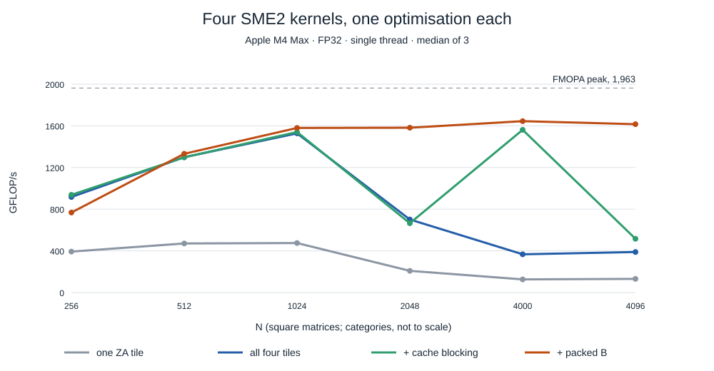

# Matrix multiplication on Apple M4's SME2 unit: from outer products to 1.6 TFLOP/s

*Apple M4 Max, one thread unless stated. Every number in this article was
measured on that machine; the code is in
[hpc-math-core](https://github.com/vdeviatkov/hpc-math-core). The kernel
starts from the CPU SIMD kernel of [part 1](simd-gemm.md).*

> **Matrix multiplication, from SIMD to Tensor Cores** · 1. [SIMD on CPU cores](simd-gemm.md) · **2. The SME2 matrix unit** (this article) · 3. [Cache-set conflicts](sme2-cache-associativity.md) · 4. [CUDA on an RTX 5080](cuda-gemm.md) · 5. [Low-precision formats](lowp-gemm.md)

Apple's M4 is the first Apple chip that exposes its matrix unit through a
public instruction set: ARM's Scalable Matrix Extension, SME2. This article
builds a single-precision matrix multiplication (GEMM) for it from scratch
and measures what each design decision is worth, from the instruction up to
the caches and the TLB.

**Key results**

- The SME unit completes one 16 × 16 FP32 outer product (512 flops) per
  cycle, but each result takes 4 cycles to feed the next: **1.96 TFLOP/s
  peak, reachable only with four independent accumulators**. There is one
  unit per performance-core cluster, not per core.
- Three steps after a one-tile baseline take the kernel from **475 to
  1,645 GFLOP/s** (84% of peak; best size of each kernel):
  use all four accumulator tiles (3.2×), block for the caches GotoBLAS-style
  with an 8 MiB A block resident in L2 (up to 4.3× at large N), and pack
  the B operand (up to 3.1× at power-of-two sizes). The four tiles are
  arranged 1 × 4, which measures up to 7% faster than the balanced 2 × 2.
- The result reaches 91–100% of Apple's own Accelerate library on the same
  core for N ≥ 1024 and beats Arm's KleidiAI micro-kernel called on the
  whole matrix at N = 4096 (1,600 vs 1,099 GFLOP/s): KleidiAI leaves cache
  blocking to its caller.
- With both SME units (`gemm_sme_mt`), **3.49 TFLOP/s FP32 and 910
  GFLOP/s FP64 at N = 4096**, 110% / 115% of Accelerate on all cores. It
  takes 8 threads, not 2: macOS cannot pin threads to clusters, and only
  more threads than one cluster has cores guarantee that both units get
  work.

## The idea in three pictures

A conventional SIMD GEMM builds C one row segment at a time (the register
tile of [part 1](simd-gemm.md) is several row segments, 6 × 16 values on
NEON, built from 24 vector FMAs per k step). SME2 builds it one square
block at a time:

```text
Conventional SIMD GEMM (NEON)         SME2 outer-product GEMM

  A(i,k)       scalar of A            A(i..i+15, k)   column of A, 16 values
    ×                                   ×
  B(k,j..j+3)  row of B, 4 values     B(k, j..j+15)   row of B, 16 values
    │                                   │
    ▼                                   ▼
  vector FMA                          FMOPA
    │                                   │
    ▼                                   ▼
  C(i,j..j+3)  one row segment        16 × 16 accumulator tile in ZA
    │                                   │
    ▼                                   ▼
  4 multiply-adds                     256 multiply-adds
```

One FMOPA multiplies every element of a column vector `a` by every element
of a row vector `b` and adds each product into its own accumulator:

```text
                b[0]          b[1]         …    b[15]
       a[0]  [ +a[0]·b[0]    +a[0]·b[1]    …    +a[0]·b[15]  ]
       a[1]  [ +a[1]·b[0]    +a[1]·b[1]    …    +a[1]·b[15]  ]
        …    [     …             …         …        …        ]
       a[15] [ +a[15]·b[0]   +a[15]·b[1]   …    +a[15]·b[15] ]

       32 values loaded → 256 multiply-adds: each value is used 16 times
```

Repeating this for k = 0 … K−1, with `a` from column k of A and `b` from
row k of B, leaves a finished 16 × 16 block of C in the tile.

**Why one tile is not enough.** Each FMOPA reads its tile and writes it
back, so the next FMOPA on the same tile has to wait for the previous
result, which takes 4 cycles. The unit itself can start a new FMOPA every
cycle. With one tile it sits idle three cycles out of four; with four
independent tiles there is always one whose result is ready:

```text
cycle        1   2   3   4   5   6   7   8
one tile     T0  ·   ·   ·   T0  ·   ·   ·     1 FMOPA / 4 cycles: 25% of peak
four tiles   T0  T1  T2  T3  T0  T1  T2  T3    1 FMOPA / cycle: peak
```

ZA holds exactly four FP32 tiles. The kernel arranges them as a 1 × 4 row
covering a 16 × 64 block of C, which has a second benefit: the one loaded
A vector feeds all four FMOPAs, so a k step loads 5 vectors for 4 FMOPAs
instead of 8. Everything after this is about keeping those four tiles fed: the
caches, the TLBs, and the layout of A and B in memory.

## The machine

The test machine is a 16-core M4 Max: 12 performance cores in two clusters
of six, plus four efficiency cores. What macOS reports for a performance
core (`sysctl hw`), and what had to be measured:

| | Size | Load latency, cycles | Source |
|---|---|--:|---|
| P-core clock | 3.94–3.99 GHz | | measured |
| Cache line | 128 B | | sysctl |
| Page | 16 KiB | | sysctl |
| L1 data cache, per core | 128 KiB | 3 | sysctl, measured |
| L2 cache, per 6-core cluster | 16 MiB | 26–27 | sysctl, measured |
| System-level cache | | ~150 (32 MiB working set) | measured |
| DRAM | 64 GB | 380–440 | measured |
| First-level data TLB | 128 entries = 2 MiB | +14 on a miss | measured |
| Second-level TLB | 3,072 entries = 48 MiB | +39 for a page walk | measured |
| SME streaming vector length | 512 bits = 16 FP32 | | sysctl |

macOS reports neither the clock nor the TLBs, so both are measured. A
chain of dependent integer adds runs at exactly one add per cycle, which
gives the clock. Latencies come from a dependent pointer chase in random
order ([`cache_chase`](https://github.com/vdeviatkov/hpc-math-core/blob/main/benchmarks/experiments/cache_chase.cpp)), which defeats the prefetcher. The TLB sizes come from the same chase
with one line per page, compared against the same lines packed densely:
latency rises from 136 pages on (128 entries) and jumps again between
3,072 and 3,328 pages. Method and raw data:
[machine measurements](https://github.com/vdeviatkov/hpc-math-core/tree/main/docs/experiments/sme2-machine).

### The SME unit

SME instructions do not run in the CPU core's own vector pipelines. They
run on a matrix unit shared by a cluster, which the core drives in a
separate *streaming mode*. A loop of outer-product instructions (`FMOPA`)
on constant inputs, with no memory traffic
([`sme_fmopa`](https://github.com/vdeviatkov/hpc-math-core/blob/main/benchmarks/experiments/sme_fmopa.cpp)), measures it directly:

| | Accumulator tiles in use | Cycles per FMOPA | GFLOP/s |
|---|--:|--:|--:|
| FP32 (16 × 16 tile, 512 flops per FMOPA) | 1 | 4.09 | 494 |
| | 2 | 2.04 | 990 |
| | 4 | 1.03 | **1,963** |
| FP64 (8 × 8 tile, 128 flops per FMOPA) | 1 | 4.09 | 124 |
| | 4 | 1.01 | **500** |
| | 8 | 1.02 | 497 |

This is the timeline above, measured: an FMOPA's result is ready for the
next FMOPA on the same tile after **4 cycles**, while the unit accepts
**one new FMOPA per cycle**. At 1.03 cycles per FMOPA with four tiles and
512 FP32 flops each, that is 1.96 TFLOP/s. One tile runs at a quarter of
peak, two at half, four fill the pipeline. FP64 has the same issue rate with a quarter of the work per
instruction.

Running the same loop on several threads shows how the unit is shared:

| Threads | 1 | 2 | 4 | 6 | 8 | 12 |
|---|--:|--:|--:|--:|--:|--:|
| Total GFLOP/s | 1,963 | 1,954 | 2,830 | 3,912 | 4,007 | 4,203 |

Two threads that land on the same cluster get no more than one: they share
its SME unit. Spread across both performance clusters, the total
approaches twice the single-thread figure (3,912 with 6 threads, 4,007
with 8). With 12 threads it reaches 4,203, 7% above two units' worth: the
efficiency cluster has an SME unit too. Run with background QoS, which
macOS keeps on the four efficiency cores (1.66 GHz), the same loop
measures 180–265 GFLOP/s FP32 in total
([data](https://github.com/vdeviatkov/hpc-math-core/blob/main/docs/experiments/sme2-machine/fmopa_ecores.csv)),
about the 277 GFLOP/s the 12-thread run gains over two P-cluster units (2 × 1,963).
Within one cluster, a second thread adds nothing.

## Outer products instead of dot products

The pictures at the top, in detail. A conventional SIMD GEMM computes C
with vector FMAs: broadcast `A(i,k)`, multiply it by a row segment of B,
add into a row segment of C. Each FMA instruction does 2 × lanes flops: 8
for NEON's 4 FP32 lanes.

SME computes an **outer product**. FMOPA takes a column vector `a` and a
row vector `b`, 16 FP32 values each, and adds every product `a[r]·b[c]`
into a 16 × 16 tile of ZA, a two-dimensional accumulator array:

```text
ZA[t][r][c] += a[r] * b[c]          for r, c in 0..15      (512 flops, one instruction)
```

With `a` taken from column `k` of A and `b` from row `k` of B, `K` such
instructions produce a 16 × 16 block of `C = A·B`. Two vectors loaded
yield 256 multiply-adds, against 16 for a 16-lane vector FMA on the same
two vectors: the outer product reuses every element 16 times inside the instruction. That
is why the SME unit does 64 times the work per instruction of a NEON
FMA.

ZA holds 64 × 64 bytes: four 16 × 16 FP32 tiles, or eight 8 × 8 FP64
tiles. The streaming mode imposes rules a kernel has to design around:

- **No gather loads.** A column of a row-major A is not contiguous, and
  streaming mode cannot gather it. A must be rearranged before the kernel
  reads it.
- **Mode switches cost.** Entering and leaving streaming mode (`smstart`,
  `smstop`) saves and restores state, so the switch belongs around large
  blocks of work, not inside loops.
- **ZA is shared state.** A function that uses ZA without declaring it
  makes the compiler save and restore ZA around every call (below, this
  costs 5×).

In C++, Clang's ACLE intrinsics express all of this:
`__arm_locally_streaming` makes a function enter and leave streaming mode,
`__arm_new("za")` gives it fresh ZA state, and `svmopa_za32_m(tile, pg, pg,
a, b)` is one FMOPA.

### What peak demands from memory

One step of the kernel developed below loads one A vector and four B
vectors (320 bytes) and issues four FMOPAs (2,048 flops): 6.4 flops per
byte. At one FMOPA per cycle that is **80 bytes of operands every cycle**,
about 315 GB/s, from wherever the operands live. The rest of this article
is about keeping that traffic in a cache close enough to deliver it.

## Step 1: one accumulator tile — 475 GFLOP/s

The simplest SME GEMM accumulates each 16 × 16 block of C in one tile:

```text
for each 16-column block j of C:
    for each 16-row block i of C:
        zero tile 0
        for k in 0 .. K-1:
            a = A[i .. i+15, k]        // contiguous after packing A, see step 4
            b = B[k, j .. j+15]        // contiguous in row-major B
            FMOPA tile 0 += a ⊗ b
        store tile 0 to C[i .. i+15, j .. j+15]
```

It peaks at **475 GFLOP/s** (N = 1024), 96% of the 494 GFLOP/s a single
dependent FMOPA chain allows: the kernel is entirely latency bound. Every
FMOPA waits for the previous one on the same tile, while three quarters of
the unit's issue slots stay empty.

Code: [`gemm_sme_1tile`](https://github.com/vdeviatkov/hpc-math-core/blob/main/src/gemm/sme.hpp), the 1×1 shape of the shared macro-kernel.

## Step 2: all four tiles — 1,528 GFLOP/s

Four tiles accumulate a 16 × 64 block of C as a row of four 16 × 16
tiles. Each step loads one A vector and four B vectors and issues four
independent FMOPAs:

```cpp
for (std::int64_t k = 0; k < kc; ++k) {
    const auto a  = svld1(pa, a_strip + k * mr);          // A rows 0-15
    const auto b0 = svld1_x2(pb0, b_strip + k * ldb);     // B columns 0-15 and 16-31, one instruction
    const auto b1 = svld1_x2(pb1, b_strip + k * ldb + 32);// B columns 32-47 and 48-63
    mopa<T, 0>(a, svget2(b0, 0));   // tile 0: C columns 0-15
    mopa<T, 1>(a, svget2(b0, 1));   // tile 1: C columns 16-31
    mopa<T, 2>(a, svget2(b1, 0));   // tile 2: C columns 32-47
    mopa<T, 3>(a, svget2(b1, 1));   // tile 3: C columns 48-63
}
```

(In the source, `outer_step` generates this pattern for any R × V tile
shape, loading vectors two at a time with SME2's multi-vector loads; for
1 × 4 it compiles to the loop above.)

Four independent chains fill the FMOPA pipeline, and the A vector now
feeds four FMOPAs instead of one. Code: [`gemm_sme_tiles` and its
`macro_kernel`](https://github.com/vdeviatkov/hpc-math-core/blob/main/src/gemm/sme.hpp).

**Why 1 × 4.** The balanced 2 × 2 (a 32 × 32 block) loads fewer vectors,
2 + 2 per four FMOPAs, yet measures slower: 1 × 4 leads it by 7.3% at
N = 1024 and 2.9% at 4096 in the complete kernel, and the tall 4 × 1 is
8–14% behind both. On cache-resident operands every shape runs the FMOPA
loop at 99–100% of peak, so the difference is in moving data around the
loop, not in the outer products
([docs/kernels/sme.md](https://github.com/vdeviatkov/hpc-math-core/blob/main/docs/kernels/sme.md)).
FP64 uses 1 × 4 too: an 8 × 32 block of C in four of its eight tiles,
enough to fill the pipeline, and 0.4–3.7% faster than the 8-tile 2 × 4.

| N | 256 | 512 | 1024 | 2048 | 4000 | 4096 |
|---|--:|--:|--:|--:|--:|--:|
| one tile, GFLOP/s | 393 | 471 | **475** | 208 | 126 | 131 |
| four tiles, GFLOP/s | 917 | 1,299 | **1,528** | 701 | 367 | 389 |



The gain is 2.3–3.2×, but from N = 2048 both kernels collapse. Without
blocking, every 64-column strip of B is streamed against all of A, so all
of A (16 MiB at N = 2048) is re-read once per strip and can no longer stay
in the 16 MiB L2. The kernel needs a structure that bounds what each loop
touches.

## Step 3: GotoBLAS blocking — 1,562 GFLOP/s at N = 4000

Kazushige Goto's design, used by GotoBLAS, OpenBLAS, BLIS and most vendor
libraries ([Goto and van de Geijn,
2008](https://dl.acm.org/doi/10.1145/1356052.1356053)), splits the
multiplication into blocks sized for each level of the memory hierarchy and
orders the loops so that each block is reused many times while it is
cached:

```text
for jc in 0 .. N step Nc:                  Nc = 4096 columns of B and C (FP32 sizes)
  for pc in 0 .. K step Kc:                Kc = 2048
    B panel = B[pc .. pc+Kc, jc .. jc+Nc]  (32 MiB, FP32)
    for ic in 0 .. M step Mc:              Mc = 1024 (FP64: 512)
      A block = A[ic .. ic+Mc, pc .. pc+Kc] (8 MiB)
      macro-kernel (streaming mode):
        for jr in 0 .. Nc step 64:         one B strip, Kc × 64 = 512 KiB
          for ir in 0 .. Mc step 16:       one A strip, 16 × Kc = 128 KiB
            load C[ic+ir .. +16, jc+jr .. +64] into ZA (or zero it when pc = 0)
            for k in 0 .. Kc-1:  4 FMOPAs  (the step-2 micro-kernel)
            store ZA to C
```

Code: [`gemm_sme_blocked` and `blocked_driver`](https://github.com/vdeviatkov/hpc-math-core/blob/main/src/gemm/sme.hpp).

A macro-kernel runs the micro-kernel repeatedly to compute a larger block
of C. For the measured FP32 configuration on M4, with full-sized blocks:

| Level | Computes |
|---|---|
| Micro-kernel | A 16 × 64 C tile, accumulating over the current K block (up to 2,048 steps) |
| Macro-kernel | A 1024 × 4096 C block by visiting those tiles, for one K block |
| GEMM driver | The entire matrix, including packing and accumulation across K blocks |

The macro-kernel controls **reuse between tiles**. The micro-kernel
controls **loads and arithmetic within one tile**. Edge blocks can be
smaller than the dimensions above.

In `sme.hpp`, the micro-kernel is `outer_step()`, an always-inlined
helper that shares `macro_kernel()`'s ZA state, so it compiles into the
macro-kernel's k loop rather than being called. The macro-kernel enters
streaming mode, owns ZA, and processes many C tiles before leaving
streaming mode.

Each loop level fixes one operand while the levels inside it reuse it:

| Loop | Iterations at N = 4096 | Held fixed | Size | Reused by | Lives in |
|---|--:|---|--:|---|---|
| `k` | 2,048 | C micro-tile | 4 KiB | every k step | ZA |
| `ir` | 64 | B strip | 512 KiB = 32 pages | 64 A strips | L2 |
| `jr` | 64 | A block | 8 MiB = 512 pages | 64 B strips | L2 |
| `ic` | 4 | B panel | 32 MiB = 2,048 pages | 4 A blocks | system cache and DRAM |
| `pc` | 2 | (splits K) | | | |
| `jc` | 1 | (splits N) | | | |

The orders matter:

- **`k` innermost** keeps C in ZA for 2,048 steps; C crosses memory once per
  `pc` block instead of once per step.
- **`ir` inside `jr`**: a B strip is fetched from beyond L2 once and then
  read from L2 by 64 A strips in a row. An A strip is reused once per B
  strip, after the whole A block has passed through, so the A block must
  remain in L2 for reuse: at 8 MiB, it occupies half the measured L2 capacity.
  This is a residency target, not a guarantee against eviction.
- **`ic` inside `pc`** means each B panel is packed once and serves every A
  block. A is the operand repacked more often: each element of A is packed
  `N / Nc` times, each element of B once.
- **Large `Kc`** amortises the round trip of C through ZA (once per `Kc`
  steps); **`Nc`** bounds the B panel. The panel does not fit in L2 and
  does not need to: only the current strip has to.

### Why put the B-strip loop outside the A-strip loop?

The macro-kernel revisits the smaller packed A block while streaming the
larger B panel strip by strip:

```cpp
for (jr ...)          // select one B strip
    for (ir ...)      // reuse it across all A strips
        micro_kernel();
```

At the measured M4 FP32 sizes:

| Operand or cache | Size |
|---|---:|
| Packed A block: 1024 × 2048 floats | 8 MiB |
| Packed B panel: 2048 × 4096 floats | 32 MiB |
| One B strip: 2048 × 64 floats | 512 KiB |
| P-cluster L2 | 16 MiB |

With **`jr` outside `ir`**, one 512 KiB B strip serves 64 A strips
consecutively. Moving to the next B strip rereads the 8 MiB A block,
which is intended to remain in L2.

With **`ir` outside `jr`**, each A strip would scan the entire 32 MiB B
panel. By the next A strip, that scan exceeds the 16 MiB L2 capacity, so
much of B would have to be fetched again from beyond L2. This is the
cache-reuse argument for the chosen order, not a measured comparison of
the two loop orders. The target is to revisit the operand that fits and
stream the operand that does not; actual residency also depends on
associativity, conflicts, C traffic and competing work.

The outer driver makes a separate reuse decision:

```cpp
for (jc ...)
    for (pc ...) {
        pack_B_panel();
        for (ic ...) {
            pack_A_block();
            macro_kernel();
        }
    }
```

Putting `ic` inside lets one packed B panel serve every M block,
amortizing B packing. The panel need not remain in L2 between those
blocks for the packed copy to be reused.

These two decisions follow from SME's packed layout and working sets.
The SIMD driver has a different operand-reuse pattern and uses an
[i-first blocked traversal](simd-gemm.md#cache-blocks-measured-too).

This is GotoBLAS's classic arrangement, A resident and B streamed, one
cache level further out. Classic GotoBLAS keeps the A block in L2 and
reuses each B micro-panel from L1. Here B strips are reused from L2,
consistent with measurements suggesting operand access through the
P-cluster L2. This is an inference about M4, not an SME architectural
requirement or a documented internal datapath.
The evidence in [part 3](sme2-cache-associativity.md) points to L2 set
conflicts: the kernel (measured there with the 2 × 2 arrangement)
collapses at about 600 rows per B strip, some 75 times the 8 rows one L1
set holds.

The packing code that writes the blocks runs on the core, and its TLBs
cover them: a B strip (32 pages) fits the 128-entry first-level TLB, and
an A block (512 pages) and an FP32 B panel (2,048 pages) the 3,072-entry
second-level TLB. FP64's 64 MiB B panel, 4,096 pages, does not fit it.

| N | 256 | 512 | 1024 | 2048 | 4000 | 4096 |
|---|--:|--:|--:|--:|--:|--:|
| four tiles, GFLOP/s | 917 | 1,299 | 1,528 | 701 | 367 | 389 |
| + blocking, GFLOP/s | 938 | 1,298 | 1,541 | 665 | **1,562** | 516 |

Blocking holds throughput up at N = 4000 (4.3× over unblocked) but
leaves holes at exactly N = 2048 and N = 4096. That is the B layout, the
subject of the last step.

### Choosing the block sizes

The obvious alternative uses L2 the other way round: keep the **B panel**
resident and pass small A blocks through it: Mc = 128 and Kc = 1024, a
16 MiB B panel, the whole L2, and 512 KiB A blocks. Each B strip is then
reused by only 8 A strips before the next one is needed, and the panel,
which competes with A and C for the same 16 MiB, keeps partly falling out.

A sweep of the complete kernel (step 4 below) with Mc, Kc and Nc as
run-time arguments, configurations in round-robin order, median of 3 at
N = 4096 and Nc = 4096
([`sme_block_sweep`](https://github.com/vdeviatkov/hpc-math-core/blob/main/benchmarks/experiments/sme_block_sweep.cpp)),
shows where the optimum is:

| GFLOP/s by Mc (rows), Kc (depth) | Kc = 1024 | 2048 | 4096 |
|---|--:|--:|--:|
| Mc = 128 (B panel resident) | 1,404 | | |
| 256 | 1,428 | 1,509 | 1,564 |
| 512 | 1,453 | 1,573 | **1,584** |
| 1024 | 1,474 | 1,565 | 1,494 |
| 2048 | 1,471 | 1,462 | 1,276 |

The best shape of each A-block size (Mc × Kc × 4 bytes) rises up to
8 MiB and falls at 16 MiB, the size of L2. Two 8 MiB shapes lead,
512 × 4096 and 1024 × 2048, 1.3% apart; compiled in with the six leading
blocks and interleaved (5 repetitions), 1024 × 2048 is within 0.6% of the
best at N = 512, 1024 and 4096 (1,598 GFLOP/s at N = 4096 against 1,607
for 512 × 4096), and it is the default. FP64 elements are twice as large,
so FP64 uses Mc = 512 for the same 8 MiB A block. Against the B-resident
sizing, the default is 11% faster at N = 4096 and 4% at 2048 in FP32, 7%
and 3% in FP64.

The optimum also depends on the matrix size, so for each size there is a
best Mc, Kc and Nc, and a kernel can choose them per call from M, N and K.
The same sweep at each N, FP32, best sizes against the fixed choice:

| N | Best for this N (Mc, Kc, Nc) | GFLOP/s | Fixed (1024, 2048, 4096) | Gain |
|---|---|--:|--:|--:|
| 512 | 1024, 4096, 2048 | 1,127 | 1,125 | +0.2% |
| 1024 | 256, 2048, 2048 | 1,579 | 1,466 | +7.8% |
| 2048 | 512, 4096, 4096 | 1,508 | 1,472 | +2.4% |
| 4096 | 512, 4096, 4096 | 1,584 | 1,565 | +1.3% |

With the blocks compiled in, the N = 1024 advantage disappears (256 ×
2048 × 2048: 1,575 against 1,574 GFLOP/s), so the gap in the run-time
sweep reflects run-time loop bounds more than the blocks. Tuning block
sizes empirically is an established practice: ATLAS, for example,
searches them for each machine when it is installed. For square matrices
on this machine the fixed set is within 0.6% of the best compiled-in
blocks, so `gemm_sme` keeps it. The sweep covered square matrices only;
strongly non-square shapes may have optima further from the fixed set.

## Step 4: packing A and B — 1,645 GFLOP/s, no cliff

Both operands are copied into **strips**: narrow blocks laid out so that
each step of the micro-kernel reads one contiguous run of memory. A is
packed in every kernel from step 1 on, because SME cannot load it any other
way; what step 4 adds is packing B. This
section summarises why each operand needs them; part 3 of this series,
[*A power-of-two stride cuts SME2 GEMM throughput by two thirds*](sme2-cache-associativity.md),
takes the B strips apart in detail: how their rows map to cache sets, where
the conflicts happen, and what packing them costs and saves.

### Packing A: a transpose

FMOPA needs a 16-element column segment of A as one contiguous vector. In
row-major A those 16 values are a full row apart, and streaming mode has no
gather. So before the macro-kernel runs, each A block is copied into
**strips**: 16 rows of the block, stored column by column, so step k of the
micro-kernel reads 16 contiguous floats (64 bytes):

```text
strip[k * 16 + r] = A(i0 + r, pc + k)      r in 0..15, k in 0..Kc-1
```

The copy is a transpose. It is done with NEON 4 × 4 in-register
transposes (`vtrn1q_u32`, `vtrn2q_u32`, then swapping 64-bit halves with
`vcombine_u32`, on the raw bits), which doubled packing bandwidth over a scalar loop and
made the whole GEMM about 10% faster ([`pack_a`](https://github.com/vdeviatkov/hpc-math-core/blob/main/src/gemm/sme.hpp)). Packing runs before the macro-kernel
enters streaming mode, in the core's own NEON pipes; the SME unit only
ever sees packed data, and the mode switch happens once per 1024 × 2048 ×
4096 block.

### Packing B: control over the stride

B's 64-element row segments are already contiguous, so the kernel can read
B in place. But consecutive rows of a strip are then `N × 4` bytes apart:
16 KiB at N = 4096, 8 KiB at N = 2048. At such a power-of-two stride the
2,048 rows of a strip appear to compete for a handful of L2 cache sets
(part 3) and evict each
other before the next A strip reuses them; throughput falls to a third at
N = 4096 (516 GFLOP/s) and to under half at N = 2048 (665). Packing copies
each strip into 2,048 contiguous 256-byte rows, which fill all sets evenly
whatever N is ([`pack_b`](https://github.com/vdeviatkov/hpc-math-core/blob/main/src/gemm/sme.hpp); [`gemm_sme`](https://github.com/vdeviatkov/hpc-math-core/blob/main/src/gemm/sme.hpp)
is the blocked driver with both operands packed).
[Part 3](sme2-cache-associativity.md) traces that cliff in detail.

| N | 256 | 512 | 1024 | 2048 | 4000 | 4096 |
|---|--:|--:|--:|--:|--:|--:|
| blocking, B in place, GFLOP/s | 938 | 1,298 | 1,541 | 665 | 1,562 | 516 |
| blocking, B packed, GFLOP/s | 768 | **1,332** | **1,580** | **1,582** | **1,645** | **1,616** |

FP64, B packed: 320 / 409 / 442 / 428 / 433 / 425 GFLOP/s at the same
sizes (one run, median of 3,
[data](https://github.com/vdeviatkov/hpc-math-core/blob/main/docs/experiments/sme2-gemm/ladder.json)).

### What packing costs

Timing each phase of the full multiplication at N = 4096, median of 15,
with the 2 × 2 tile arrangement (32-column strips)
([`sme_b_layout`](https://github.com/vdeviatkov/hpc-math-core/blob/main/benchmarks/experiments/sme_b_layout.cpp), data in
[experiments/sme-b-stride](https://github.com/vdeviatkov/hpc-math-core/tree/main/docs/experiments/sme-b-stride)):
packing A takes 3.8 ms and packing B 4.9 ms of a 91 ms call, about 10%
together, and the compute takes 82 ms whatever B's original stride was:
1,670 GFLOP/s, 85% of peak. Packing B is itself slowed by the 16 KiB
stride it reads from; with rows padded to 16,512 B it takes 2.5 ms and
the two copies 7% of the call. At small N the copy shows: below N = 1024
the unpacked kernels are faster (938 vs 768 GFLOP/s at N = 256), because
the whole problem fits in L2 anyway.

## Step 5: both SME units — 3.5 TFLOP/s

Code: [`gemm_sme_mt`](https://github.com/vdeviatkov/hpc-math-core/blob/main/src/gemm/sme.hpp).

Everything above runs on one thread, so it uses one SME unit. The M4 Max
has two: one per P-cluster, each cluster six P-cores
(`sysctl hw.perflevel0.cpusperl2` = 6). Every core of a cluster sends its
SME instructions to the same unit. `gemm_sme_mt` spreads `gemm_sme`'s
blocking over several threads, as multi-threaded GotoBLAS does:

- for each B panel, every thread packs a share of its strips into one
  shared buffer;
- after a barrier, threads take chunks of rows of A from an atomic
  counter, pack them into their own A buffer and run the same macro-kernel;
- a second barrier keeps the panel intact until the last chunk is done.

**Two threads would be enough, if they landed on different clusters.** One
thread already drives a unit at 1,592 GFLOP/s; a second thread on the
same cluster only shares that unit. But macOS cannot pin a thread to a
cluster: Apple Silicon does not support the thread-affinity API, and
placement is up to the scheduler, which in these runs kept short-lived
threads on one cluster. Measured, GFLOP/s, wall clock, median of 3
([data](https://github.com/vdeviatkov/hpc-math-core/tree/main/docs/experiments/sme-mt)):

| Threads | FP32 N = 1024 | 2048 | 4096 | FP64 N = 1024 | 2048 | 4096 |
|--:|--:|--:|--:|--:|--:|--:|
| 1 | 1,536 | 1,553 | 1,592 | 423 | 399 | 414 |
| 2 | 1,690 | 1,868 | 2,921 | 466 | 720 | 839 |
| 6 | 1,812 | 2,802 | 3,350 | 647 | 845 | 915 |
| 7 | **2,808** | 2,881 | **3,607** | **791** | 892 | 901 |
| **8** | 2,768 | **3,096** | 3,500 | 767 | 885 | 920 |
| 12 | 2,606 | 3,053 | 3,551 | 779 | 876 | 926 |
| Accelerate, all cores | 3,253 | 3,263 | 3,149 | 825 | 792 | 790 |

- At N = 1024 a call lasts about a millisecond and two threads run barely
  faster than one (1,690 against 1,536): both stay on one cluster. At
  N = 4096 a call lasts tens of milliseconds, the scheduler has time to
  move one, and two threads reach 1.8×.
- **More than six threads force both units.** Six threads still fit on one
  cluster; with more than six, at least one must run on the other. The
  jump from 6 to 7 threads at N = 1024 (1.8 → 2.8 TFLOP/s) is that spill.
  8 is the best or within 3% of the best of every count measured (3, 4 and
  10 threads are in the data), so it is the count used. Twelve, one per
  P-core, gain nothing.
- **Dynamic chunks make the extra threads harmless.** With an equal band
  of rows per thread, the unit that hosts more threads would finish last.
  With chunks taken from a counter, a unit with more threads simply takes
  more chunks.
- **The price is cores.** Eight P-cores are occupied to keep two units
  busy, most of them waiting their turn on a shared unit. The threads are
  also created on every call, which, with placement, keeps N = 1024 at
  87% of Accelerate; below N ≈ 512 the single-threaded `gemm_sme` is
  faster (250 against 16 GFLOP/s at N = 64).

From N = 2048 up, `gemm_sme_mt` matches or beats Accelerate with all
cores: at N = 4096, 3.49 TFLOP/s FP32 (110%, 89% of the two units'
3.93 TFLOP/s) and 910 GFLOP/s FP64 (115%, 91% of 1.00 TFLOP/s), Accelerate
measured in the same run ([where it stands](#where-it-stands)).
A persistent thread pool, which would remove the per-call thread start-up,
has not been tried.

## Engineering details that decide the result

- **Declare ZA usage on every helper.** A streaming helper function without
  `__arm_inout("za")` or `__arm_preserves("za")` is "private-ZA": Clang will
  not inline it into the kernel and wraps every call in a lazy save of the
  ZA state. Inside the k loop that takes the kernel from about 1,290 to
  270 GFLOP/s (not part of the recorded data).
- **Compile for the CPU, not the architecture.** `-march=armv9-a+sme2`
  compiles, but the resulting binary dies with `SIGILL`: Clang sizes the ZA
  save area with a non-streaming SVE instruction, which Apple's cores do not
  implement. `-mcpu=apple-m4` avoids it. Since only running the binary
  reveals this, the build compiles and runs a small SME program to choose
  the flags.
- **Pad edges in the packing, not in the kernel.** Packing fills partial
  strips with zeros, so every FMOPA runs on full vectors with an all-true
  predicate; only the loads and stores of C into ZA are predicated at the
  matrix edges.

## Correctness

Every kernel in the repository, all four SME steps included, is checked
by the test suite ([`tests/test_gemm.cpp`](https://github.com/vdeviatkov/hpc-math-core/blob/main/tests/test_gemm.cpp),
run with `ctest`):

- **Reference.** Each kernel's output is compared element by element with
  `gemm_naive`, a plain triple loop. That reference is itself checked
  against hand-computed products (a 2 × 2 case, a 2 × 3 by 3 × 2 case,
  multiplication by the identity and by zero).
- **Tolerance.** An element passes if `|C − C_ref| ≤ tol · (1 + |C_ref|)`,
  with tol = 1e-4 for FP32 and 1e-10 for FP64: an absolute bound near
  zero and a relative one for larger values. Inputs are uniform in
  [−1, 1] with fixed seeds. C is filled with junk (123) before each call,
  so a kernel that accumulates into C instead of overwriting it fails.
- **Shapes.** 32 (M, K, N) shapes, each run in FP32 and in FP64 (KleidiAI:
  FP32 only):
  - squares of 1–5, 7, 8, 13, 15–17, 31–33, 64, 100, 128 and 256: below,
    at and just past the vector and tile widths;
  - rectangular shapes with partial tiles in every dimension, such as
    3 × 5 × 2, 17 × 33 × 15, 33 × 1 × 65 and 257 × 64 × 31;
  - shapes that cross every cache block: K = 4113 crosses Kc = 2048
    twice, so partial sums are reloaded into ZA; M = 1031 crosses Mc
    (1024 in FP32, 512 in FP64); N = 4103 crosses Nc = 4096;
  - empty matrices (M, K or N = 0).
- **Edges.** Dimensions that are not multiples of the 16 × 64 micro-tile
  (or 8 × 32 in FP64) take the zero-padded strips and predicated C
  loads and stores of the edge path; the odd sizes above exercise them in
  every dimension.
- **Packing and layout.** Packing A is checked to be a pure bit move on
  random bit patterns, NaN payloads, denormals and −0 included. B read in
  place is checked with a leading dimension larger than N, junk in the
  unused columns, and K across Kc.

The test shapes are small enough to run in seconds. The large sizes
benchmarked here are not compared element by element in the suite, but
every code path they take (full and partial blocks, K split across Kc
blocks) is exercised by the shapes above, and the phase-timing experiment
checks each of its layouts against the packed driver before timing.

**`-ffast-math`.** Tests are built with the same Release flags as the
benchmarks, `-O3 -ffast-math`. Inside `gemm_sme` the arithmetic is SME
intrinsics, and each element of C is accumulated over k in order, one
FMOPA per k, across Kc blocks too; the packing is a bit move. The
compiler's freedom to reorder floating-point arithmetic therefore applies
to ordinary C++ code such as the reference loop, which is why the
comparison uses a tolerance rather than exact equality. `-ffast-math` also
lets the compiler assume there are no NaNs or infinities: the tests use
finite inputs only, and propagation of NaN and infinity through the GEMM
is neither tested nor guaranteed.

## Where it stands

GFLOP/s by matrix size. `gemm_sme` is single-threaded, so the fair
comparison is with Accelerate restricted to one thread
(`VECLIB_MAXIMUM_THREADS=1`); Accelerate's default, multi-threaded figures
are listed separately. Peak is 1,963 GFLOP/s FP32 and 500 FP64 for one SME
unit, twice that for two. Each table is one run
([single thread](https://github.com/vdeviatkov/hpc-math-core/blob/main/docs/experiments/sme2-gemm/head_to_head.json),
[all cores](https://github.com/vdeviatkov/hpc-math-core/blob/main/docs/experiments/sme-mt/default.json)). The
libraries are called through thin wrappers:
[`gemm_kleidiai`](https://github.com/vdeviatkov/hpc-math-core/blob/main/src/gemm/kleidiai.hpp) and, for Accelerate's
`cblas_sgemm` / `cblas_dgemm`, [`gemm_amx`](https://github.com/vdeviatkov/hpc-math-core/blob/main/src/gemm/amx.hpp).

| One thread | N = 256 | 512 | 1024 | 2048 | 4096 | best, % of one unit's peak |
|---|--:|--:|--:|--:|--:|--:|
| NEON, blocked, register-tiled, FP32 ([part 1](simd-gemm.md)) ¹ | 123 | 124 | 121 | — | 102 | 86% of NEON's ~144 |
| `gemm_sme`, FP32 | 770 | 1,323 | 1,556 | 1,546 | **1,600** | 82% |
| Arm KleidiAI, FP32 | 1,072 | 1,509 | 1,694 | 1,560 | 1,099 | 86% |
| Apple Accelerate, FP32, single thread | 1,707 | 1,697 | 1,653 | 1,704 | 1,599 | 87% |
| `gemm_sme`, FP64 | 320 | 407 | **433** | 422 | 431 | 87% |
| Apple Accelerate, FP64, single thread | 461 | 423 | 366 | 394 | 394 | 92% |

| All cores (Accelerate's default) | N = 256 | 512 | 1024 | 2048 | 4096 | best, % of two units' peak |
|---|--:|--:|--:|--:|--:|--:|
| Apple Accelerate, FP32, all cores | 1,717 | 2,581 | 3,207 | 3,231 | 3,162 | 82% |
| Apple Accelerate, FP64, all cores | 463 | 784 | 830 | 788 | 794 | 83% |
| `gemm_sme_mt`, FP32, 8 threads ² | 392 | 1,659 | 2,781 | 3,116 | **3,487** | 89% |
| `gemm_sme_mt`, FP64, 8 threads ² | 291 | 626 | 761 | 896 | **910** | 91% |

² Median of 5 interleaved repetitions, in the same run as the Accelerate
rows: 110% (FP32) and 115% (FP64) of Accelerate at N = 4096. Step 5's
thread sweep is a separate run.

¹ Part 1's kernel with its 6 × 4 tile and default cache block; NEON's peak
assumes the 4.49 GHz core clock measured in part 1's register-tile runs.
The SME rows ran at 3.94–3.99 GHz, so the two are from different runs and
clocks. Part 1's [packed-B kernel](simd-gemm.md#step-5-pack-b)
(`gemm_simd_packed<Q>`) removes NEON's drop at N = 4096: 120 GFLOP/s
there, 123 at N = 1024, from a separate run.

- SME is **13× the best NEON result** on the same core (1,600 GFLOP/s at
  N = 4096 against 124 at N = 512; at N = 4096 alone, 16×), from different
  runs and clocks.
- On one thread, `gemm_sme` reaches 91–100% of Accelerate for N ≥ 1024 in
  FP32, and in FP64 it is within 4% at N = 512 and ahead from N = 1024.
  Accelerate's lead is largest at small N, where `gemm_sme`'s fixed costs
  (allocating and packing buffers, entering streaming mode) are not
  amortised.
- KleidiAI uses a 2 × 2-tile micro-kernel, written in assembly by Arm, and
  packs both operands. It is a micro-kernel library and leaves cache
  blocking to the caller; called once on the whole matrix, as here, it
  leads at N ≤ 1024 and falls to 1,099 GFLOP/s at N = 4096.
- With all cores, Accelerate roughly doubles its one-thread throughput
  from N = 1024 up (FP32 1.9–2.0×; FP64 2.0–2.3×, the 2.3× at N = 1024
  where its one-thread FP64 dips to 366), as two SME units predict.

## Takeaways

1. **Measure the instruction first.** FMOPA's latency-to-throughput ratio
   of four sets the minimum number of independent accumulators, and the
   single-tile kernel landing at 96% of the single-chain ceiling proves the
   diagnosis.
2. **Count bytes per flop, then measure the shape.** Peak needs ~315 GB/s
   of operands, so how each loaded vector is reused matters; but the
   balanced 2 × 2, which loads the fewest vectors, is up to 7% slower than
   the 1 × 4 the measurements chose: the difference lies in moving data
   around the loop, not in the loop.
3. **Block for the cache the unit actually uses, and decide what stays
   there.** The SME unit is fed from the cluster's L2, so GotoBLAS's blocks
   are sized for L2, not L1. Keeping an 8 MiB A block resident and
   streaming B through it beats keeping a 16 MiB B panel resident by up to
   11% at N = 4096: the resident block should fill about half the cache, not all of
   it.
4. **Pack both operands.** A must be transposed for the hardware; B is
   packed to make performance independent of the caller's layout. Together
   the copies cost 7–10% and remove a 3× cliff.

5. **Count the units, then make sure the threads reach them.** Two SME
   units need two threads in principle, but without pinning the scheduler
   decides; on M4 Max only more threads than one cluster's six cores
   guarantee both units, and work taken from a shared counter keeps the
   uneven placement from costing time.

**Next:** [part 3](sme2-cache-associativity.md) takes that cliff apart: why
a 16 KiB row stride cuts the throughput to a third, which cache the
conflicts are in, and what padding and packing each cost.

## Reproduce

```bash
git clone https://github.com/vdeviatkov/hpc-math-core && cd hpc-math-core
cmake -B build -DCMAKE_BUILD_TYPE=Release -DHPC_ENABLE_SME=ON   # Apple M4 or later
cmake --build build --parallel
ctest --test-dir build

./build/benchmarks/bench_gemm --benchmark_filter='Sme|KleidiAI'   # the kernels
VECLIB_MAXIMUM_THREADS=1 ./build/benchmarks/bench_gemm --benchmark_filter=Amx
./build/benchmarks/bench_gemm --benchmark_filter='^SmeMtT'          # thread-count sweep (wall clock)
./build/benchmarks/sme_fmopa                                       # FMOPA latency and throughput
./build/benchmarks/cache_chase sizes                               # cache latencies
./build/benchmarks/cache_chase tlb                                 # TLB sizes
```

The kernels are in
[`src/gemm/sme.hpp`](https://github.com/vdeviatkov/hpc-math-core/blob/main/src/gemm/sme.hpp),
the four steps and `gemm_sme_mt`, as templates over the element type, the
ZA tile shape and the cache blocks. Raw data for every table here:
[experiments/sme2-gemm](https://github.com/vdeviatkov/hpc-math-core/tree/main/docs/experiments/sme2-gemm)
and [experiments/sme2-machine](https://github.com/vdeviatkov/hpc-math-core/tree/main/docs/experiments/sme2-machine);
full benchmark tables:
[docs/benchmarks.md](https://github.com/vdeviatkov/hpc-math-core/blob/main/docs/benchmarks.md).
Benchmarks are medians of repeated runs on a desktop machine under
moderate load; each experiment's folder records its conditions.
